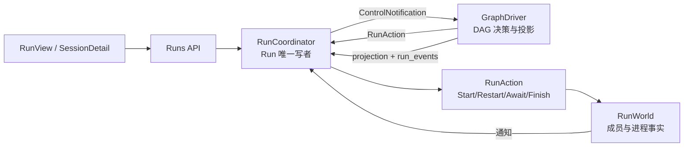
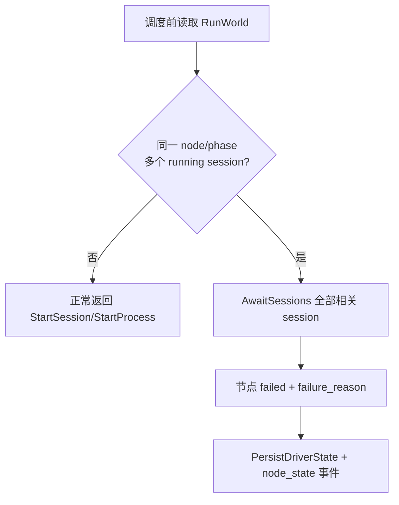

# Graph Driver（Run 架构）

> **当前实现以 Run 架构为准。** 本文件后面的旧 GraphRunner 章节是历史背景，保留用于解释
> YAML/DAG 语义；它描述的 `GraphRunner`、独立 `/graph/:id` 和 `/api/graph/*` 不再是运行时
> 入口。当前入口是 `Runs API → RunCoordinator → GraphDriver`，详细的暂停/恢复协议见
> [pause-resume-spec.md](pause-resume.md)。

## 当前调用关系



GraphDriver 只读 `RunWorld`、更新自己的快照并返回动作；它不直接访问控制台、RunStore 或
SessionPool。RunCoordinator 顺序执行动作，并把 session/process 结局重新投递给驱动。因此
同一个节点的用户操作和自动调度不会形成两条并行写路径。

## 从旧 GraphRunner 语义到当前实现

| 源语义 | 当前落点 | 行为 |
| --- | --- | --- |
| graph 状态和节点状态持久化 | `GraphState.snapshot()` 经 `PersistDriverState` 写入 RunStore | 快照属于 Run，GraphDriver 不持有数据库句柄 |
| pause/resume/stop | Runs API → RunCoordinator → `ControlNotification` | 组控和成员控都沿同一条 Run 通道顺序化 |
| 执行 session / 验收 session | `NodeActivity` 的执行阶段与验收阶段 | `opsbot_session_id` 与 `verify_session_id` 分开维护，恢复时按阶段复用 |
| 运行历史与实时刷新 | `node_history`、`node_state`、`projection_updated` 的 run 事件 | RunView 通过事件游标拉取，不调用旧 graph 端点 |
| 崩溃恢复 | `GraphState` 将中断的 `running` 保留为 `stopped`，`prepare_recovery()` 再按 RunWorld 对账 | 可复用成员继续，消失成员才重排为新执行 |

## 当前的执行/验收不变量

```text
一个 NodeActivity
    ├─ 执行：StartProcess / StartSession
    ├─ 结局：ProcessExit / SessionOutcome
    └─ 验收：script 或独立 verifier session
          ├─ passed → 节点 passed，清理 verify_session_id
          └─ failed → 记录反馈；有重试次数才重新调度
```

验收没有结论时不会启动下一次执行。验收反馈在节点 `failure_reason` 中保留最多 5000
字符，重试提示最多注入 2000 字符；这是源修复在 RunDriver 中的两个不同预算。重试、失败
节点重开和回滚会同时清理两个 session 字段，避免旧验收成员被误当成下一轮执行成员。

## workflow-orchestrator YAML 的提示词

使用 `task_type: normal` 的节点时，执行会话和验收会话都收到
`goal`、`acceptance` 和 `out_of_scope`。执行会话收到 `approach`，
验收会话收到可选的 `procedure`。从主图加载的 normal 子图节点遵循同一规则。

主图顶层 `system_prompt` 以 `$SYSTEM_PROMPT=...` 加入执行和验收的任务提示，
与 workflow-orchestrator 的 YAML 语义一致。运行参数中的 `system_prompt`
仍用于运行时的模型配置。验收结果由 graph 驱动按现有协议判定。

## workflow-orchestrator YAML 的状态文件

如果主图节点引用 `.workflow/status.json`，启动及从快照恢复时会在工作目录下
补建该文件。它提供原始工作流 YAML 的绝对路径（`workflow`）、本次运行的提示词
文件路径（`user_prompt`）和工作目录（`work_dir`）。原始 YAML 路径也供节点查找
与工作流同仓的资源。任务状态继续由 RunStore 管理。

发布触发是对翻译后的节点做字面子串匹配：节点命令/提示里需直接写出
`.workflow/status.json` 字面量（或模板渲染后含该字面量）才会触发；经变量间接
引用（如 `cat {{STATUS_FILE}}`）在翻译期不展开，不会命中，属有意启发式。

固定路径在同一个工作目录只能指向一次运行。已有文件三键齐全且与本次运行一致时
可以继续使用；三键齐全但值不同时报告冲突（该目录已属于其他工作流或运行）；三键
缺失（旧版工作流整体重写或文件损坏）视为陈旧残留并重新发布。为新运行选择独立的
工作目录可避免冲突。

## 重试预算与 attempt 计数

节点的 `attempts` 与 `retries` 是两个独立计数：

- `attempts` 是展示/历史计数，参与 `node_history` 事件的 `(gen, attempt)` 去重；
  续跑（reopen/resume）对 failed/skipped 节点保留 attempts，让新一轮执行拿到递增
  的 attempt 号，不覆盖之前失败尝试的历史记录。
- `retries` 是本续跑周期内的重试预算消耗，验收失败进入 `retry` 去向时递增，
  与 `max_retries` 比较决定 retry/continue/rollback/fail；它不参与展示。

清零时机：全新重跑（`_reset_node_for_rerun`）无论是否保留 attempt 都会把 `retries`
清零，让每次重跑拿到完整重试预算，同时清理上一轮的验收失败原因；回滚
（`reset_rollback`）同样把 `retries` 与 `attempts` 一并清零，被回滚的节点在回滚后
能拿到完整重试预算，否则会立即耗尽 `max_retries` 再次回滚直至 `rollback_budget`
耗尽。

## 当前的重复 session 防线

RunCoordinator 的决策轮是串行的；GraphDriver 在调度前按 `node=<id>` 与
`node=<id>/verify` 扫描 `RunWorld`。同一节点/阶段出现多个运行成员时，驱动会发出
`AwaitSessions` 停止相关成员、清除活动和定时器、把节点标为 `failed`，随后持久化并推送
投影更新，不会继续创建第三个成员。旧 generation 的归档成员不参与当前代检查。



这些规则与暂停/恢复的完整时序一起维护在 `pause-resume-spec.md`；本文件的后续旧章节
只作为历史设计参考，不能据此新增旧入口或跨边界调用。

> 读 yaml DAG 配置 → 调度 bash/agent 节点 → 状态持久化 + 崩溃恢复。

## 概览

把 [PR #686](https://gitcode.com/opencann/skills-dev/pull/686) 引入的 `ops-registry-invoke-workflow.yaml`（21 节点 DAG）这种「确定性工作流 yaml」跑在 opsbot 里，作为一个 plugin 而非侵入 core。

**三层归属**：

| 对象 | 是否进 SessionPool | 前端访问 |
|---|---|---|
| graph 本身 | ❌ plugin 自管 `graph_id` | `/graph/:graph_id` 独立路由 |
| bash 节点 | ❌ subprocess + state.output | graph 视图内点节点弹窗 |
| agent 节点 | ✅ `start_session_with_config` | 点节点跳 `/session/:opsbot_session_id` |

## 端到端使用流程

1. workflow-controller web → Settings → enable graph plugin
2. Dashboard → 「导入」→ Graph tab → 填 yaml 路径 + OP 变量 + 代理框架 + 会话模型 → 加载
3. 跳 `/graph/:graph_id` → 显示 DAG 静态图
4. 点「开始」→ 按拓扑序调度节点，bash 真并行、agent 串行（`_agent_semaphore(1)`）
5. 点 agent 节点 → 跳 session 详情页看 LLM output；session 详情页也有 Graph tab 渲染 mini-view + node 运行历史
6. 点 bash 节点 → 弹窗看 stdout
7. 暂停 = 阻塞下一轮 + 暂停在跑的 agent session；续跑 = 唤醒 + 重启主循环 + resume session

## YAML Schema

兼容 PR #686。穿刺版识别以下字段，忽略 `executor`/`agents_dir` 以外的 agent 路由（agent 节点用 `--agent executor` 传给 opencode，agent 定义从 yaml 的 `agents_dir` 软链接到 cwd）。

```yaml
workflow: my-workflow       # graph_id 后缀
max_parallel: 2              # asyncio.Semaphore 限流（仅 bash 节点）
variables: { OP: '{{argv.OP}}' }
nodes:
  - id: setup
    task_type: bash          # bash | agent
    command: "mkdir -p ..."
    acceptance:
      enabled: true
      type: script           # 只支持 script 验收
      script: "test -d ..."
    depends_on: []
  - id: build
    task_type: agent
    executor: developer      # 传给 opencode --agent developer
    task_description: "..."
    task_goal: "..."
    acceptance: { enabled: true, type: script, script: "test -s output.txt" }
    depends_on: [setup]
```

> agent 节点单轮执行（LoopConfig max_iterations=1, evaluator=always_complete），
> 通过/失败由验收脚本判定；失败后可从 Graph 页续跑重试，不在 session 内多轮自纠错。

## 架构

```
GraphPlugin (Plugin)
  ├── install(): 从 events.db graphs 表恢复未完成 graph + 注册 LOG_QUERY observer
  ├── load_graph(): 读 workflow yaml → DAG → 读 work_dir/opsbot.yaml 拿项目级
  │                 reviewer 配置（model/timeout_seconds/task_goal）作 fallback →
  │                 前端传参覆盖 → 生成 graph_id → 创建 GraphRunner → 写 graphs 表
  │                 （graph_id = sha256(yaml_path + work_dir + runtime + model + variables)）
  ├── get_sse_events(): 周期拉 state snapshot + bash output 推 SSE
  ├── get_graph(): 合并 DAG 拓扑 + state + node history 数（attempts 用历史记录数）
  ├── reload_graph(): 从 DB 重新加载 state 到内存（修正内存与 DB 不一致）
  └── web_api: 9 个 FastAPI 端点（load/list/node-history/get/reload/start/pause/resume/stop）

GraphRunner
  ├── run(): asyncio 主循环 — 取就绪节点 → FIRST_COMPLETED 重算就绪集 → 收尾
  │   收尾前检查 paused/stopped 状态与 stopped 节点，不误标 completed/failed
  ├── _run_one(): Semaphore 限流 + pause_event 阻塞 + NodeExecutor.execute
  ├── pause()/resume()/stop(): asyncio.Event + 暂停/恢复/终止 agent session
  │   stop() 先 await kill_bash_procs 终止所有在跑 bash 进程组（含 fork 子进程），
  │   再 cancel _node_tasks + await gather，最后标 stopped
  ├── resume(): failed→pending(重跑) / stopped 有 session→running+resume_session(续跑)
  │   / stopped 无 session→pending / running（pause loop 活着的）→resume_session
  └── start_async(): 重置 failed/stopped 节点为 pending + spawn run()
                       （stopped 必须一并重置，否则续跑时中断节点永不执行）

NodeExecutor
  ├── execute(): 跑 executor → 跑验收脚本 → 写 state（passed/failed + failure_reason）
  │              + node history（_save_history：同 session UPDATE，新 session INSERT）
  ├── _run_bash(): create_subprocess_exec(start_new_session=True) + stdout 逐行
  │                append_output + emit LOG_QUERY；维护 node_id→Process 映射，stop 时
  │                可对整个 pgid 发 SIGTERM/TERM
  ├── _run_agent(): 已有 running/user_pause session → 复用等待；否则 start_session_with_config
  │                → wait_session_done → 建 .opencode/agents 软链接
  │                 构造 SessionReviewerConfig 时传 model（从 load_graph 的
  │                 reviewer_model 来，load_graph 读 opsbot.yaml fallback），
  │                 不再用代码默认值 claude-opus-4-6
  │   pause loop: session 被暂停时轮询等 resume，暂停期间被停掉抛 PausedSessionStopError
  ├── kill_bash_procs(): 终止所有在跑 bash 进程组 + 并发 await wait 回收
  └── _verify_script(): bash 跑 acceptance.script，用 communicate() 同时排空
                          stdout/stderr 管道（避免输出超 64KB 缓冲区时子进程阻塞
                          在 write、wait() 永不返回的死锁）+ 300s 超时

GraphState
  ├── events.db graphs 表持久化（nodes_json）+ 线程安全 Lock
  ├── 崩溃恢复：仅 running → pending（stopped 保持不动）
  ├── 不在 __init__ 时 flush（防止旧 worker reload 覆盖 DB）
  ├── increment_attempts(): attempts 计数器递增
  └── reload_from_db(): 从 DB 重新加载，丢弃内存状态

EventStore (graph 相关)
  ├── graphs 表：graph_id/workflow/yaml_path/work_dir/status/runtime/model/variables/nodes_json
  ├── graph_node_history 表：append-only 运行历史（id/graph_id/node_id/attempt/status/opsbot_session_id/failure_reason）
  ├── store_graph(_sync): INSERT OR REPLACE graphs 记录
  ├── update_graph_status(_sync): UPDATE graphs 的 status + nodes_json
  ├── get_graph_sync(): 查 graphs 表
  ├── list_graphs_sync(): 列所有 graph（恢复时用）
  ├── store_node_history(): INSERT 新记录
  ├── update_node_history_status(): UPDATE 已有记录（resume/cancel/complete 时）
  └── get_node_history_sync(): 同步查询（get_graph 里算 history count）

```

## 节点状态机

```
                    ┌── passed（验收通过，终态）
pending → running ──┤
    ↑              ├── failed（验收失败/executor 报错，终态）
    │              └── stopped（用户停止，可恢复断点）
    │                    ↑
    └────────────────────┘  resume: stopped → running
```

- **pending**：等待执行
- **running**：执行中（agent session 在跑或 pause loop 中）
- **passed**：验收脚本 exit 0（终态，`_TERMINAL`）
- **failed**：executor 报错或验收脚本 exit != 0（终态，`_TERMINAL`），写入 `failure_reason`
- **stopped**：用户主动停止，可恢复断点（不在 `_TERMINAL` 里）

> `_TERMINAL = {"passed", "failed", "skipped"}`。`stopped` 不是终态——DAG 调度器不会把 `stopped`
> 当作依赖已满足，下游节点不会提前跑；重启恢复时 stopped → pending；续跑时有 session 的
> stopped 节点原地 resume，无 session 的与 failed 一并重置为 pending。

## run_on_failure 与失败传播

普通节点的「就绪」要求依赖**全部 passed/skipped**；依赖出现 failed 时普通节点应被 skip，
不会执行。但收尾/报告类节点需要**依赖失败仍执行**——声明 `run_on_failure: true` 即跳过
「依赖全 passed」检查，只要依赖都进入终态（passed/failed/skipped）就调度。

`run()` 主循环在「无就绪节点、无在跑任务」时，**先把被失败依赖阻断的普通节点（pending、
非 run_on_failure、依赖已全部终态但并非全 passed/skipped）标记为 skipped 再 continue**，
而非立即退出。这是失败沿普通中间节点传播的关键：

- 例 `A(failed) → B(普通) → C(run_on_failure)`：若不先把 B 标 skipped，C 的依赖 B 仍非
  终态，`get_ready` 永远不返回 C，最终 B/C 一起被收尾清扫 skip，C 形同虚设。
- 标记 B 为 skipped 后，下一轮 C 的依赖全部终态且（B=skipped）满足「全 passed/skipped」，
  C 进入就绪集执行。
- `stopped` 不在 `_TERMINAL`，依赖 stopped 节点的下游不会被 `get_ready` 返回，因此暂停
  语义不受影响（续跑时 stopped 节点 resume，下游随后解锁）。

最终退出循环后，若 graph 状态为 failed，仍会兜底把剩余 pending 节点标 skipped（覆盖
stopped 等无法传播的场景）。

## 并发模型

| 节点类型 | 并行 | 机制 |
|---|---|---|
| bash 节点 | ✅ 真并行 | `_semaphore(max_parallel)` + asyncio.create_subprocess_exec |
| agent 节点 | ❌ 串行 | `_agent_semaphore(1)` — opsbot SingleLoopEngine 单槽位 |

`_agent_semaphore(1)` 确保 agent 节点一次只跑一个。bash 节点不受此限制，可与 agent 节点并行。

## 暂停/续跑语义

### 暂停（pause）
- `_pause_event.clear()`：阻塞下一轮 `_run_one` 入口
- 正在跑的 agent session 调 `orchestrator.pause_session()`
- `_run_agent` 的 pause loop 检测到 `stop_reason == "user_pause"` → 进入轮询等待
- bash 节点不能真暂停（subprocess 无法 SIGSTOP），跑完当前回合才阻塞
- **验收（verify）agent 的暂停/续跑**：验收 agent 是独立 session（记录在 node history 的 `verify_session_id`），与执行 agent（`opsbot_session_id`）分开。graph 暂停时须一并暂停正在跑的 verify agent；node 标 `stopped`（非 failed）；续跑时复用该 verify session 从断点继续，**不得重新起新 session**。为此 state 每节点新增 `verify_session_id` 字段，`runner.pause()`/`resume()` 与 `_verify_agent` 都围绕它做「执行 session」同等的暂停/续跑处理。

### 续跑（resume）
- `_pause_event.set()`：唤醒
- **failed 节点** → 重置为 `pending` → `run()` 重新调度，创建新 session
- **stopped 节点（有 session）** → 设为 `running` + `resume_session` + 创建 `_run_one` 等 session 完成后走验收
- **stopped 节点（无 session）** → 重置为 `pending` → 创建新 session
- **running 节点**（pause loop 还活着的）→ `resume_session` 唤醒

## 停止语义

`stop()` 是 async：先 `await kill_bash_procs()` 终止所有在跑 bash 进程组（`start_new_session=True` 创建的独立 pgid，对 pgid 发 SIGTERM/TERM 杀整个进程树，含 bash fork 出的 git/Python 子进程），再 cancel `_node_tasks` + `await gather` 让 `_run_one` 的 `CancelledError` 路径把节点标 stopped，最后标 graph stopped。仅取消协程不会给子进程发信号——节点显示 stopped 后 bash 子进程仍会继续修改 work_dir。

### Session 详情页联动
- session 页暂停 → 同时调 graph pause API
- session 页恢复 → 同时调 graph resume API
- 验收通过/失败的 session → resume 按钮灰色禁用

## Node History

每次 node 执行记录到 `graph_node_history` 表：

| 时机 | 操作 |
|---|---|
| 新建 session | INSERT `running` 记录 |
| session 完成 + 验收 | UPDATE → `passed` / `failed` |
| 暂停被 stop（PausedSessionStopError）| UPDATE → `stopped` |
| cancel（CancelledError）| UPDATE → `stopped` |
| resume 暂停的 session | UPDATE → `running` |

前端用 history 记录的 `index + 1` 显示"第 N 次"，不依赖 `attempts` 计数器。前端 node 框上显示的运行次数取自 `get_graph()` 返回的 `attempts` 字段（实际是 history 记录数）。

## SSE 实时更新

- 后端 `get_sse_events()` 每次 SSE tick 推送完整 graph state snapshot
- SSE 事件名：`graph:graph:{graph_id}:state`
- 前端 session 详情页通过 `subscribePlugin('graph', ...)` 订阅，实时更新 mini-view
- graph 页面通过 `useGraph().startPolling()` 轮询

## 崩溃恢复

1. opsbot 重启 → `GraphPlugin.install()` → `_recover_graphs()`
2. 从 `events.db` 的 `graphs` 表读取所有非 `completed` 的 graph（`store.list_graphs_sync()`）；从 `config_json` 读 `reviewer_enabled`/`reviewer_model`/`reviewer_task_goal`/`evaluator`/`max_iterations`/`system_prompt` 重建 GraphRunner
3. 按 `yaml_path`/`work_dir`/`variables`/`runtime`/`model` 重建 GraphRunner
4. `GraphState.__init__` 从 DB 加载 `nodes_json`，仅把 `running` → `pending`（`stopped` 保持不动）
5. `__init__` 不 flush（防止旧 worker reload 时覆盖 DB）
6. 用户进 `/graph/:graph_id` → 点「续跑」→ `resume()`：有 session 的 stopped 节点原地续跑，failed/无 session 的重置为 pending 从断点继续

## 文件清单

```
src/workflow_controller/plugins/graph/
├── config.yaml          # enabled: false（默认关）
├── dag.py               # DAG + Kahn O(V+E) 查环
├── state.py             # DB 持久化 + 崩溃恢复 + increment_attempts + reload_from_db
├── template.py          # {{VAR}} 嵌套渲染
├── node_executor.py     # bash/agent 两路 + script 验收 + kill_bash_procs 进程组终止
│                        # + PausedSessionStopError 暂停处理 + _save_history 运行历史
├── runner.py            # asyncio 主循环 + 暂停/续跑/停止（async stop）
├── plugin.py            # GraphPlugin（install/load/recover/SSE/get_graph/reload_graph）
└── web_api.py            # 9 个 REST 端点（含 /reload、/node-history）

核心改动（为 graph 加的）：
├── config/settings.py   # SessionConfig 加 agent_name 字段
├── driver/opencode.py   # _build_args 支持 --agent <name>
├── driver/protocol.py   # Driver.query 加 agent_name 参数
├── driver/claude_*.py   # 签名对齐
├── session/session.py  # 传 agent_name 给 driver
├── plugin/context.py    # PluginContext 加 work_dir
├── plugin/registry.py   # 注入 work_dir
└── store/event_store.py # graph_node_history 表（node 运行历史）+ node history 读写方法

前端：
├── views/GraphView.vue          # DAG SVG + 状态色 + 控制按钮 + node history modal
├── views/SessionDetailView.vue  # session 详情页 Graph tab（mini-view + SSE + history）
├── composables/useGraph.ts      # API client + 轮询
├── composables/useGraphLayout.ts # barycenter 布局 + statusColors/Labels
├── composables/usePlugins.ts    # pluginEnabled()
├── composables/useSSE.ts        # subscribePlugin()
├── components/NewSessionModal.vue # 导入 modal Graph tab + parseGraphVars
├── views/DashboardView.vue      # 导入 modal Graph tab
└── router.ts                    # /graph/:id 路由
```
