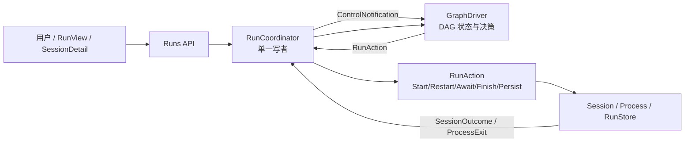
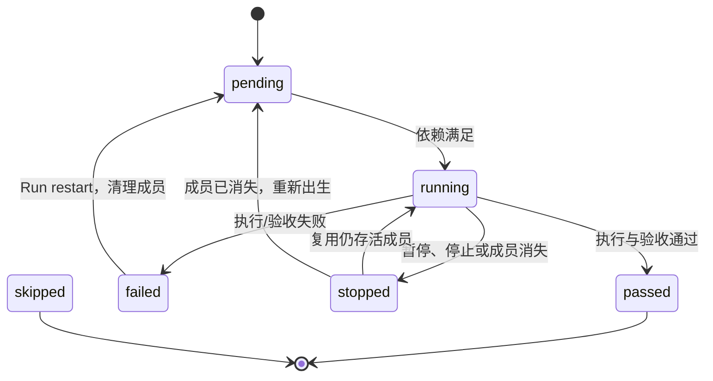
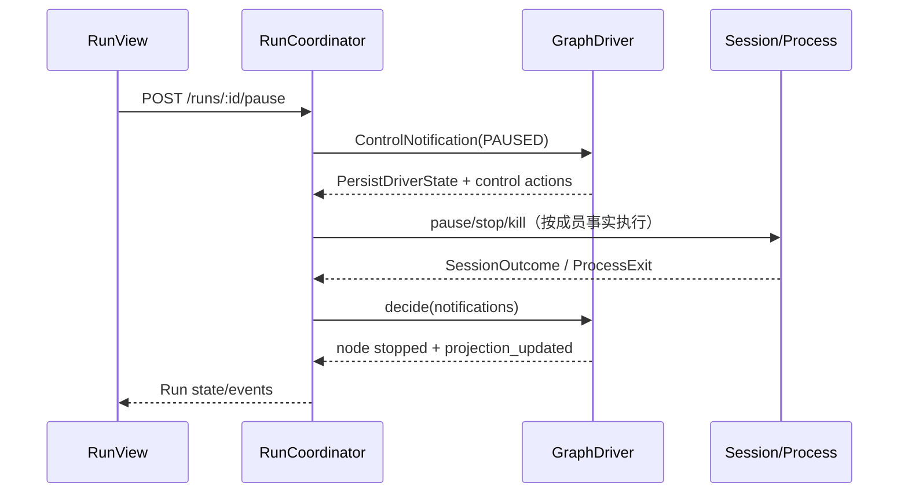
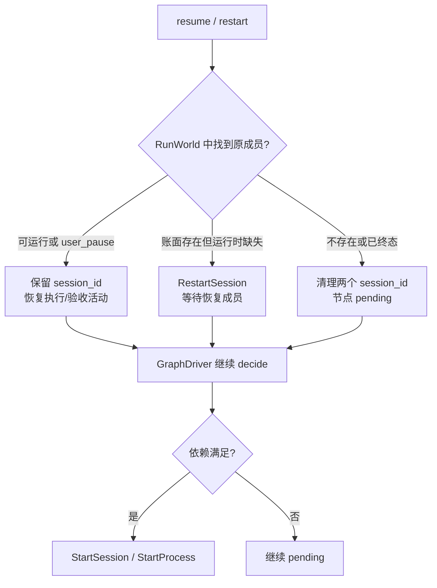
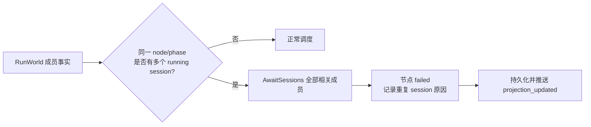

# Graph 工作流暂停、恢复与状态推导（Run 架构）

本文把 Graph 工作流放在当前 Run 架构中说明。Run 是账面、控制和事件的唯一公共锚；GraphDriver 只负责 DAG 决策，RunCoordinator 负责把用户控制转换为驱动通知并执行驱动返回的动作。旧的独立 Graph API、GraphRunner 和 GraphView 不属于当前调用链。

## 1. 责任边界



GraphDriver 不直接调用 Web API、RunStore 或 SessionPool。控制台也不直接调用 GraphDriver；它只调用 Runs API。这样暂停、恢复、重启和成员操作都经过同一个 RunCoordinator 顺序化，避免用户操作与驱动决策同时写状态。

## 2. 节点和 Run 状态

节点状态由驱动快照保存：

| 状态 | 含义 | 是否允许继续调度 |
| --- | --- | --- |
| `pending` | 等待依赖或等待重新调度 | 是 |
| `running` | 执行、验收或暂停恢复等待正在进行 | 否 |
| `passed` | 执行和验收均通过 | 终态 |
| `failed` | 执行或验收失败 | 终态，重开时新建执行成员 |
| `skipped` | 失败依赖传播后的跳过 | 终态 |
| `stopped` | 暂停/停止留下的可恢复断点 | 否 |

GraphDriver 每轮根据节点快照推导 Graph 投影，优先级固定为：

```text
running  >  failed  >  paused(stopped)  >  completed  >  pending
```



`running > failed` 是并行节点的关键规则：一个节点失败时，其他节点仍在运行，Run 仍显示 `running`；只有没有运行节点时，失败才把 Run 推导为 `failed`。节点每次变更都会通过 `node_state`/`projection_updated` 事件让 RunView 重新拉取投影，不能只更新内存而不重推导。

## 3. Run 级暂停

RunView 的暂停请求走 `POST /api/v1/runs/{run_id}/pause`。RunCoordinator 先把请求转成 `ControlNotification(PAUSED)`，再交给 GraphDriver：

1. 驱动设置组暂停标记，取消节点成员和进程的墙钟定时器。
2. Coordinator 执行驱动返回的停止/暂停成员动作；尚未结束的执行成员和验收成员都保留在 Run 成员账面中。
3. 节点在收到暂停结局或读对账时落为 `stopped`，并保留 `opsbot_session_id`、`verify_session_id`。
4. 没有失败节点时，投影变为 `paused`；已有失败节点时仍为 `failed`，但暂停断点不丢失。



暂停不是删除成员：暂停的 agent 成员仍可被恢复；bash 进程不能原地冻结，停止时由 Coordinator 终止进程组，恢复时按成员是否还存在决定复用或重跑。

## 4. Run 级恢复和重开

RunView 的恢复请求走 `POST /api/v1/runs/{run_id}/resume`。驱动在下一轮决策中按当前 RunWorld 成员事实处理节点：

| 节点状态 | 成员事实 | 行为 | session 结果 |
| --- | --- | --- | --- |
| `stopped` | 原执行/验收成员仍 `running`，或 `idle + user_pause` | 恢复等待活动；必要时发 `RestartSession(RESUME_IF_PAUSED)` | 复用原 session |
| `stopped` | 成员在账面但运行时暂时不在池中 | 发恢复动作，等待重新挂载 | 仍复用原 session |
| `stopped` | 没有成员、成员已终态，或 bash 已被终止 | 清理节点成员字段并回到 `pending` | 新建 session/进程 |
| `failed` / `skipped` | 任意 | 清理执行和验收成员，回到 `pending` | 新建 session/进程 |
| `running` | 暂停受理窗口中尚未落 `stopped` | 依成员事实继续等待或恢复 | 不重复出生 |

`restart` 只对已结束的 Run 生效；它重新打开 Run 并复用同一驱动快照。恢复中的节点不增加新的 attempt，失败节点重新执行才增加新的 attempt。这样服务重启和用户重开都不会因为把断点误当成全新 `pending` 而产生重复 session。



## 5. 单节点执行、验收与重试

每个节点在 GraphDriver 内只有一个 `NodeActivity`。执行和验收是同一活动的两个阶段，严格按下面顺序推进：

```text
StartProcess / StartSession
        │ 结局
        ▼
acceptance（script 或独立 verifier session）
        │
        ├─ passed  → 节点 passed，清理 verify_session_id
        └─ failed  → 保存完整反馈；仍有重试次数才回到 pending
```

验收未产生结论时不能开始下一次执行。验收 session 完成后必须清理 `verify_session_id`；重试、恢复失败节点和回滚都同时清理执行与验收 session 字段。恢复验收阶段时只恢复验收成员，不能把它写入执行成员字段。

验收反馈的持久化上限是 5000 字符，注入下一轮重试提示的上限是 2000 字符。前者保留足够的失败证据供 RunView 和事件回放查看，后者限制 prompt 大小；两者都从反馈前缀截取，行为与源修复一致。

## 6. 并发重复成员的硬保证

RunCoordinator 的驱动决策是串行的，GraphDriver 在每轮调度前还按 `node=<id>` 和 `node=<id>/verify` 上下文扫描 RunWorld：



命中重复执行或重复验收时，驱动会停止相关成员、清理活动和定时器、把节点标为 `failed`，不会再出生第三个 session。历史节点或已回滚代的成员不计入当前 generation，避免旧代成员误触发硬检查。

## 7. Session Detail 的成员操作

workflow Run 的成员暂停、恢复、停止和注入都走 `/runs/{run_id}/sessions/{session_id}/...`。Session Detail 只负责发请求并显示结果，不直接写 GraphDriver 状态。Coordinator 将成员操作回投为 `SessionControlApplied`，GraphDriver 据此更新对应节点：

- 成员暂停：节点先落 `stopped`，再由结局事件确认；其他节点继续运行时 Run 保持 `running`。
- 成员恢复：仅 `stopped` 节点可恢复；原成员可复用则恢复活动，已消失则回到 `pending` 重新调度。
- 成员自然完成或验收通过/失败：按钮由 session 终态和节点历史共同决定，不创建新的执行成员。

普通隐式 Run 成员仍走通用 Session API；只有 workflow 成员经过 Run 面。这条分流保持控制台、内核和 Graph 插件的隔离。

## 8. 崩溃恢复与读对账

Coordinator 重启后从 RunStore 恢复驱动快照。GraphState 会把快照中 `running` 节点转换成 `stopped` 断点，同时记录 `interrupted_nodes`；第一次 `decide` 用 RunWorld 判断原成员能否复用。RunView 读取投影时，只有运行成员确实从 RunWorld 消失才执行 `reconcile_projection` 并产生事件；`idle + user_pause` 的异步恢复窗口不会被误标为停止。

```text
快照 running
    ↓ restore
节点 stopped + interrupted_nodes
    ↓ RunWorld 对账
可复用成员 ──→ RestartSession/继续等待
不可复用成员 ─→ pending/新建成员
```

这保证了“恢复断点”与“失败重试”两种语义不混淆：前者保留 session，后者创建新 session。
