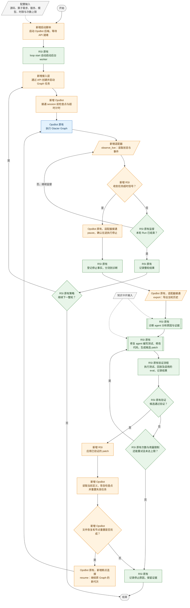
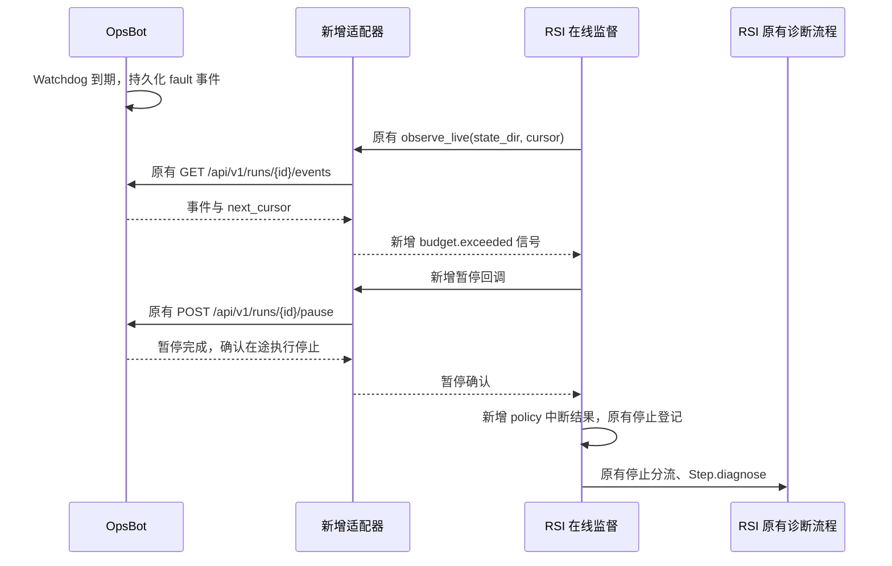

# RSI 在线时长修复闭环规格

> 本文是本项目的**最终任务规格**：RSI 在线 loop 驱动 OpsBot 执行 Glacier 工作流，任务超过固定时限后 RSI 暂停 Graph、读取导出的证据、诊断并修复，再从断点继续；整张 Graph 完成后，按配置用修复后的源码从头开始下一轮。其中「回滚」的文件态实现与语义以 [traceback 工作区隔离与统一回滚规格](traceback-workspace-rollback.md) 为准，本文不重复。
>
> 本次先验证**节点级回滚**（第 7 节 fix-findings 案例）；子代理级回滚复用同一套 Graph 管理逻辑，另需实际案例验证。本文所述闭环尚未运行过，标为「新增」的能力均需实现。

## 1. 目标与范围

- 流程：超时事件 → 暂停 Graph 并确认在途执行停止 → 导出证据 → 诊断 → 修复 agent 写测试并改代码 → RSI 原有验证 → 应用 patch → Graph 回滚 → resume 继续。
- 整张 Graph 完成才算本轮成功；随后按配置用修复后的源码、新 Run、新工作现场从头运行下一轮。
- 最小部署：RSI 与 OpsBot 同服务器，适配器通过 HTTP 控制 OpsBot；工作流修改用专用 Git 分支与运行目录，候选测试用独立目录。
- 不在范围：子代理级回滚的实测验证（保留为扩展）、跨机部署、对 RSI/OpsBot 闭环之外既有行为的重写。

## 2. 术语

| 术语 | 含义 |
|---|---|
| Run | 一次 OpsBot Graph 执行；一个 Run 可经历多次修复，每次回滚产生新的 Graph 代次 |
| `fault.subagent_timeout` / `fault.node_timeout` | OpsBot watchdog 的子代理/节点累计超时事件（后者本次新增） |
| `budget.exceeded` | 适配器向 RSI 上报的拟新增监督信号（内存事件，不需要输入文件） |
| `policy` 中断 | RSI 监督新增的停止原因类别，经原有 `resolveStopFamily()` 归入已有 F3 类进入诊断 |
| 知识卡片 | 人工提供的先验知识 Markdown（构建与测试产物一致性），供诊断与修复 agent 引用 |

检查点、作用域、闸门等回滚侧术语见 traceback 规格。

## 3. 总体流程

绿色 = RSI 原有能力，蓝色 = OpsBot 原有能力，橙色 = 本次要写或接通的代码，灰色 = 输入和起止。



## 4. 启动与部署

### 4.1 统一入口

**用户只运行新增的 `start_online.py`**：自动启动 OpsBot 后端并等待 API 就绪，再调用 RSI 原有 `loop start`（不加 `--no-spawn`）由 RSI 自动派发后台 worker。诊断、修复、验证由 RSI 原有状态机推进。最小实现用 `web --no-open` 启动后端（HTTP 与 headless 两种入口共用 `boot()`，差异仅在外部 HTTP 接口是否监听）。

目标部署布局（示例根目录可整体替换）：

```text
glacier-rsi-online/
├── workflow-rsi/bin/wie.mjs         RSI 原有 CLI
├── glacier-rsi/repro/online_rsi/
│   ├── start_online.py              新增：唯一人工启动入口
│   ├── adapter.mjs                  新增：接入 RSI 执行与观察接口
│   └── opsbot_bridge.py             新增：OpsBot API 的 HTTP/CLI 桥
├── config/
│   ├── wie.json                     RSI 全局配置（infra_root、adapter 路径、模型、验证设置）
│   ├── glacier-loop.yaml            loop 配置与产品运行参数（工作流仓库/分支、Graph YAML、
│   │                                work/、时限与上限、OpsBot 地址与启动命令）
│   ├── operator-task.md             算子需求原文
│   └── build-freshness.md           知识卡片
├── work/                            OpsBot Graph 运行目录和产物
└── infra/                           RSI loop 账本、日志和评测材料
```

OpsBot 连接与启动参数放在 `glacier-loop.yaml` 的产品运行参数中，由接入程序校验，不冒充 RSI 原生字段，不另增启动配置。启动脚本依次执行：

1. 检查输入，按配置启动 OpsBot 后端，等待 HTTP API 就绪。
2. 执行 `wie loop start <library> <version> --config … --loop-config …`，记录返回的 `loop_id` 与 worker 进程 ID（两个参数是任务标识示例，换任务就换参数）。
3. 保持存活并观察运行状态。
4. 定时（如每 30 秒）调用 `wie loop tick`，为没有活动 worker 的 loop 补发 worker（正在执行的 loop 由原有租约跳过）。
5. loop 结束或用户停止后，经原生停止入口和 OpsBot 控制接口收尾，关闭本脚本启动的 OpsBot；下次启动先核对原 loop 与 Run 状态，避免重复启动。

启动后 adapter 记录 Graph Run ID，后续暂停、回滚、继续都用这个 ID；只有整轮完成才开始新 Graph。查看状态用原生 `wie loop watch <loop-id>`；RSI 日志账本在 `infra/loops/<loop-id>/`。

### 4.2 常驻与异常恢复

三层配合：① systemd 守护 `start_online.py`（`Restart=on-failure`）；② 启动脚本定时 `loop tick`（worker 意外退出后原有租约约 60 秒失效，下一次 tick 补发）；③ 重启后从持久化账本核对原 loop ID、Run ID 和未完成操作，继续同一任务——Graph 创建、回滚、应用 patch 等外部动作需要稳定操作标识和执行后核对，避免崩溃前已成功、重启后重做（由接入层实现）。

| 情况 | 谁处理 | 动作 |
|---|---|---|
| RSI worker 崩溃，账本可继续 | RSI 原生 tick 与租约 | 租约失效后补发 worker，从账本继续 |
| 启动脚本崩溃 | systemd | 重启脚本，读取原任务记录恢复调度 |
| OpsBot 进程退出 | 启动脚本与接入层 | 重启后端、核对原 Run 与恢复状态后再继续监督；未确认恢复前不派发新任务 |
| 主机重启 | systemd 开机启动 | 恢复启动脚本，按持久化记录恢复任务 |
| 候选测试失败且允许重试 | RSI 原有 loop | 继续修复，不是崩溃 |
| 需人工处理 / 次数用尽 / 用户停止 | RSI 原有状态机 | 保持等待或终止并保留证据，不靠重启绕过 |

守护只解决程序异常退出，不保证修复成功；看到已终止或等待人工的 loop 状态时明确报告，不能删账本或新建 loop 伪装继续。

### 4.3 源码准备（loop 内部自动执行）

原生 `preflight()` 自动完成：`source()`/`buildEngine()` 按 `workflow.repo`、`workflow.branch` 解析提交并创建 worktree、执行配置的构建检查；adapter 的 `prepare` 核对任务材料并按契约返回任务**Git 仓库**（不能是普通目录），由原生 `startRun()` 建立本轮任务仓。用户准备好符合契约的源码、任务材料和配置后，启动一次即可。

## 5. 输入准备

| 输入 | 内容 |
|---|---|
| 工作流源码 | skills-dev 或 cannbot 的 Git 仓库路径、起始提交、Glacier 入口 YAML |
| 运行任务 | 算子需求与运行目录；首次先准备一次目标节点执行前的现场，之后由在线流程保存恢复位置 |
| 部署配置 | OpsBot 地址、模型与工具链、固定的节点/子代理时限，开启 traceback；RSI 诊断、修复角色及验证、eval 配置 |
| 知识卡片 | 构建与测试产物一致性说明（第 6.4 节） |

## 6. 分步职责

### 6.1 RSI 通过 API 启动 Graph

执行方：RSI 原有 loop + 新增适配器 + OpsBot 运行 API。适配器通过 API 创建并启动 Graph 任务（不启动后端进程），输出 OpsBot Run ID。RSI 修复轮次与 Run ID 分别记录。开启 traceback 后，session 开始前打点由 Graph 协调（见 traceback 规格）。

### 6.2 OpsBot 发现耗时超过阈值

- 子代理开始时注册到期定时器，到期仍在运行就发出 `fault.subagent_timeout`；完成时取消。**无论是否持续输出日志，到期检查都执行**。
- 新增节点累计超时规则，输出 `fault.node_timeout`：整图默认时限 + 单节点覆盖；从本代节点开始执行到验收结束累计计时；暂停不计时、续跑不清零、回滚到新代次重新计时、服务重启保留已用时间；同一代同一调用只报一次。
- RSI 原有 `stall_ms`（无新事件/数据增长）只作卡死兜底，不能承担持续有输出的慢任务检测；`run_wall_clock_ms` 仍管整轮时限。

### 6.3 超时事件触发 RSI 修复



适配器把 `fault.subagent_timeout` / `fault.node_timeout` 映射为 `budget.exceeded`，保留 Run/节点/session/子代理身份、节点代次、原事件 ID（去重并过滤旧代次迟到告警）、开始时间/实际耗时/阈值。若 Run 事件流缺少某子会话的告警，补齐 OpsBot 的 Run 事件关联或走公开会话事件接口。

RSI 侧补三处（路径为 RSI 仓内相对路径）：

1. `packages/evolution-loop/src/supervisor.ts::superviseRun()`：新增超时信号分支，经暂停回调调用适配器，等远端停止后结束本轮监督，返回 `policy` 中断原因。
2. `lib/loop.mjs::Step.supervise()`：接入回调与事实，沿用原有停止登记；Graph 保持可恢复的暂停状态。
3. `packages/evolution-loop/src/families.ts::resolveStopFamily()`：`policy` 中断归入已有 F3 类，经原有 `triageStop()` 进入 `Step.diagnose()`；性能中断保留自己的原因。

### 6.4 导出证据与原生诊断

`Step.diagnose()` 收集证据时，适配器调用 OpsBot 导出本轮运行目录（内部 `export_run(..., archive=False)` 或 Web 导出接口下载解包），输出 workflow、sessions、工具结果与超时事实；原生 `stop-record.json` 保存停止身份和原因。诊断 agent 获得证据目录和当前源码工作区按需读文件；数据库读取留在 OpsBot 内部。

知识卡片（Markdown，示例内容）：

> 修改源码后，确认构建系统刷新了打包源码和二进制，确认安装位置和测试实际加载位置一致。发现旧产物时先修复构建、安装或缓存失效过程，再执行原有回归。保留原验收要求，并记录每轮使用的源码和产物。

卡片经 DSH agent profile 的 `dsh.instructions` 加载，是人工先验，是否适用由诊断证据决定。诊断和修复提示还要接上「当前目标是 Glacier 工作流」的产品上下文——原有默认提示含特定引擎假设，不能只换仓库路径。

### 6.5 修复与验证

沿用普通 loop 原有顺序：诊断 → 修复 agent 写测试并改代码（先变更说明和验收用例，再写旧版会失败的测试，输出候选 patch 与 `test_command`）→ `Step.validate()` 按产品识别选择验证路径（`runValidationLadder()` / `runEvalPath()` / `validateStaticflow()`），不另建通过规则。

适配器负责让验证真正调用 OpsBot：准备相同起始输入，在隔离测试 Run 中执行旧版或候选，返回运行时间、原验收结果和证据；**测试期间主 Graph 保持暂停**；通过与否由 RSI 原有验证流程判定。**时限和原验收要求在运行前固定，修复 agent 不能靠提高时限或删减验收获得通过。**

候选未通过则保存结果、沿用当前诊断再次修复（受 `fix.max_attempts` 默认 3 次、`loop.max_tokens`、`loop.wall_clock` 限制）；失败不自动重新诊断根因——修复应用后真实 Graph 再次超时/失败会形成新的停止记录，重新分流。

### 6.6 应用修复、加载当前定义、回滚

1. RSI 在候选通过验证后将 patch 应用到本次隔离使用的工作流分支。
2. OpsBot 重新读取当前 YAML、角色和 Skill，更新**现有** Run 的任务定义（保留节点状态和产物；加载入口若会创建新 Run，需补保留现有 Run 的调用方式）。
3. 调用新增 Graph 回滚 API（异步，返回 operation_id，见 traceback 规格）；恢复时一并重置失效任务；若覆盖到修复源码，重新应用已验证 patch 再构造任务提示。

回滚完成 = 旧写入已停止、文件恢复成功、应重做任务已重置、旧 session 与验收绑定已解除、新代次状态已保存；任一步失败保持停止并记录原因。回滚不判定修复效果，效果由随后真实执行和验收确认。

### 6.7 断点继续与下一轮

回滚完成后 `run.resume`：目标及重置节点在新代次运行，通过本代验收后下游按依赖继续；再次超时回到 6.3。RSI 侧需新增「验证通过后本地应用」的选择（普通 loop 默认走 PR 并从头启动），并把继续点计算和回退契约接到 OpsBot Graph。整图完成后按配置用修复后的源码、新 Run 从头开始下一轮。

## 7. fix-findings 案例

### 7.1 为什么选它

1. 历史有可定位的重复工作：已开始跑白盒测试后发现测试使用旧产物，强制刷新、重建、重装后又执行回归（历史单次执行约 111 分钟）。
2. 存在实际采用过的处理方法：多次删除 `op/build/autogen/copy_kernel_src.timestamp` 后重建、重建并重装，提供了诊断和候选修法依据。
3. 过程由节点 executor 自主完成（338 次工具调用、0 次内部 task 调用、无人工追加消息），第一轮只需打通节点级回滚。

其他长耗时环节（code-review、run-gate、GEIR 全量等）与内部子代理候选（STYLE/SUNSET 审查、PyTorch/CANN 研究）分析后未优先选择：或因果证据不足，或无法稳定复现。这不表示 `fix-findings` 已证实能稳定复现或节省全部历史耗时，节省量由实验测量。

本例信号为 `fault.node_timeout`，恢复动作为节点级回滚，回退位置 = 该节点执行开始前。

### 7.2 优化点与验证方式

| 优化点 | 改进 | 验证 |
|---|---|---|
| 先确认产物新鲜度再跑测试（第一轮优先） | 源码、打包和安装产物一致性检查前移，发现旧产物先刷新再回归 | 核对测试实际消费的产物与当前源码一致，比较重复构建/测试次数及耗时 |
| 明确测试环境与加载路径 | 测试入口明确环境、安装路径和驱动，先确认实际加载的自定义算子 | 检查加载路径证据，比较环境排查时间，执行原有 GEIR 验收 |
| 减少无效重复回归 | 区分修改后必须重跑的项目与同一有效构建上的重复执行 | 原有验收仍被覆盖，记录各组回归次数与耗时，由 RSI 原有验证判定 |

### 7.3 需要准备什么

| 材料或能力 | 具体需要 |
|---|---|
| 固定的工作流源码 | 入口 YAML、`fix-findings` 指令、角色、Skill 和相关脚本；需核定起始源码 |
| 节点开始前的源码与产物 | `op/op_host/`、`op/op_kernel/`、`op/op_api/`、`op/op_graph/`、构建文件、`CODE_REVIEW.md`、回归测试输入和证据、所需旧安装产物（最终交付物已含修复，不能直接当作旧版现场） |
| 可执行环境 | 匹配的 Ascend 设备、CANN（历史用 9.2 + ascend950，需核对当前兼容性）、构建工具和 TTK；模型与采样配置固定 |
| Graph 起点与文件基线 | 上游产物就绪、`fix-findings` 与其下游等待执行、开启 traceback；首次准备一次，后续复用程序保存的基线 |
| 耗时判据 | 固定的节点时限与各阶段耗时记录；旧版必须真实触发该时限，候选按同一时限验证 |
| 知识卡片 | 第 6.4 节内容，人工准备并固定 |
| 在线控制与修复 | 超时信号、暂停、导出、验证、应用 patch、加载当前定义、节点回滚与恢复，按实施计划实现 |

### 7.4 跑通后应看到什么

超时后 RSI 取得本轮记录、诊断、生成候选并通过原有验证；应用候选后 OpsBot 恢复节点前检查点、建立新代次、重置失效任务，从该节点开头重跑。候选仍超时就带新证据继续修复；候选在时限内完成原验收后，Graph 自动进入真实下游；主图完成后按配置从头开始下一轮。

## 8. 接口契约

### 8.1 OpsBot 需要补充的能力

1. **子代理超时自动检查**：独立计时，无新事件也按时告警，完成后取消。
2. **节点累计超时规则**：整图默认 + 单节点覆盖；暂停不计时、续跑不清零、回滚重新计时、重启保留；同代只报一次；与原有超时/重试协调，避免告警后工作流已被别的规则结束。
3. **准确的超时告警**：含运行、节点、代次、会话、已用时间和时限，经公开接口提供。
4. **会话开始前检查点**：开启 traceback 后执行/验收会话开始前自动打点；未开启或无有效检查点时拒绝文件回滚。
5. **统一的 Graph 回滚能力**：节点级与子代理级；失效范围 = 回滚目标及其 DAG 后代（验收失败回滚另含失败节点），已通过的其余并行分支保留；新会话属原 Graph 新代次；重复请求幂等，旧代事件不影响新代。详细语义见 traceback 规格。
6. **在原 Graph 中加载修复并继续**：重读当前工作流定义、保留运行与产物；恢复失败时保持停止，不带半个现场继续。

### 8.2 RSI 一侧的改动

| 位置（RSI 仓） | 原有能力 | 需要补什么 |
|---|---|---|
| `packages/evolution-loop/src/supervisor.ts` | 轮询监督整轮超时、停滞、进程状态 | `budget.exceeded` 分支、暂停回调、`policy` 中断结果 |
| `packages/evolution-loop/src/families.ts` | 停止原因归类 | `policy` 中断入原有诊断流程 |
| `lib/loop.mjs::Step.supervise()` | 装配监督、登记停止 | 调用适配器暂停，保留超时原因与所属节点 |
| `lib/loop.mjs::Step.diagnose()`、`fixBranch()` | 诊断/修复 agent、候选提交 | 接通 Glacier 产品上下文、导出证据、知识卡片 |
| validate 与产品回放接口 | 测试执行、回放、eval、账本 | 验证经适配器调 OpsBot 隔离测试 Run，返回真实耗时与验收证据 |
| `lib/loop.mjs`、`state.ts`、`config.ts` | PR、继续点、后续轮次 | 候选本地自动应用、从 OpsBot 断点继续；整图完成后才开新 Run |

### 8.3 适配器契约

适配器只连接执行系统、搬运事实和执行控制动作；诊断和修复由 RSI 的 agent 承担。

| 适配入口 | 契约来源 | 输入 → 调用 OpsBot → 输出 |
|---|---|---|
| `prepare / engine_build` | 原有 | 仓库与起始提交 → 准备工作流源码 → RSI 可用的源码工作区 |
| `run_command` | 原有 | 工作流与任务参数 → API 创建并启动 Graph → Run ID |
| `observe_live` | 原有；事件映射新增 | 游标 → 事件 API → RSI 事件与新游标，超时映射为 `budget.exceeded` |
| `pause` | 拟新增的可选 loop 控制成员 | Run ID → pause 并确认停止 → 暂停确认；observe_live 保持只读 |
| `stop_facts / classify_stop` | 原有 | 当前 Run 与超时事件 → 节点、session、代次、时限和停止事实 |
| `evidence` | 原有 | 停止位置 → export → RSI 证据包材料 |
| `code_map` 与产品上下文 | 定位入口已有，Glacier 实现新增 | 节点与图定义 → 对应 YAML/Skill/脚本位置 |
| `replay` | 原有回放契约 | 旧版或候选、固定测试与起始文件 → 隔离测试 Run → 原始运行证据交 RSI 判定 |
| 修复后的继续 | 复用现有回退契约，补实际执行连接 | 修复源码、原 Run、节点及可选内部位置 → 加载当前定义、Graph 回滚、resume → 同一代的下一代执行 |

暂停是新增适配成员，原有适配契约需同步声明与校验；新旧入口界限在实现和测试中保留。

## 9. 实现与验收顺序

1. OpsBot 补超时告警、检查点与 Graph 账本关联、session 前快照、写入协调、当前文件加载、Graph 回滚。先验证关闭 traceback 拒绝文件回滚、开启后可恢复纯节点起点；再验证并行任务按检查点重置、存在中间产物（writer_local/rebuildable）时按 traceback 规格 §6.2 路径策略恢复，无法确定性重建则明确拒绝。
2. 实现适配器，打通事件 API、暂停、导出和节点身份关联。
3. RSI 补超时信号分支；验证收到 fault 后远端确实暂停并进入原生诊断。
4. 接通知识卡片、修复与验证流程、本地应用，用 fix-findings 跑通超时到断点继续，用原验收和固定时限判断效果。
5. 目标节点通过后继续主图；验证再次超时能再进修复，整图完成后能用当前源码从头开始下一轮。

## 10. 验收标准

- [ ] 运行一次 `start_online.py` 即可启动完整闭环。
- [ ] 超时后 RSI 收到 `budget.exceeded`，远端真实暂停，进入原生诊断。
- [ ] 候选经 RSI 原有验证判定；未通过按预算重试，不自动重新诊断。
- [ ] 候选通过后本地应用 patch、Graph 回滚并 resume；重复回滚幂等，旧代事件不影响新代。
- [ ] fix-findings 端到端跑通，候选在同时限内完成原验收；整图完成后从头开始下一轮。
- [ ] 达到上限、模型不可用或无安全恢复点时明确停止并保留证据；守护机制不删账本、不伪装继续。
