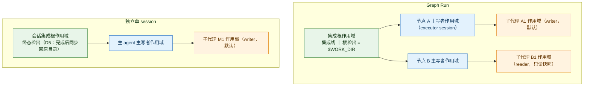
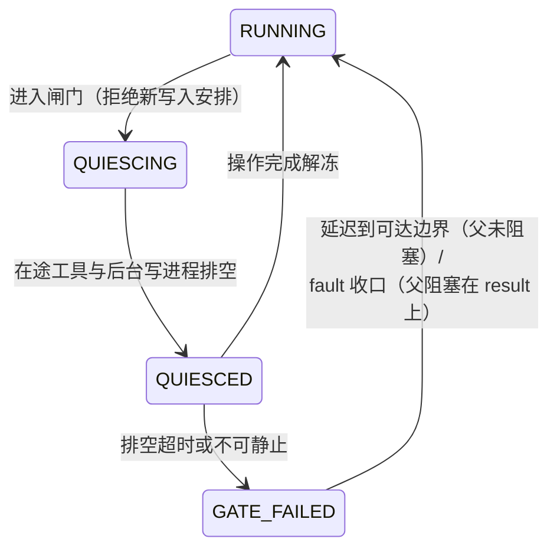
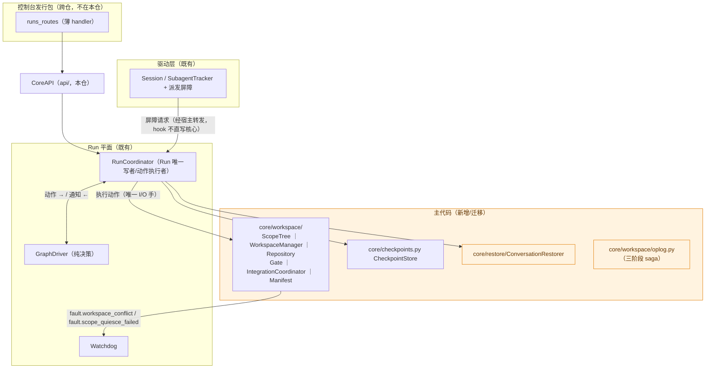
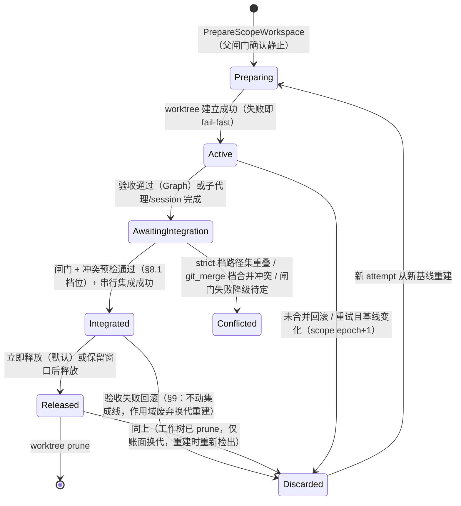
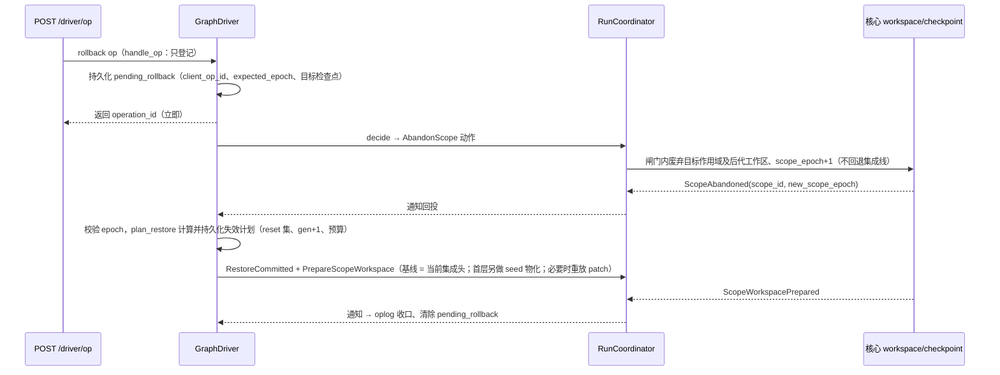
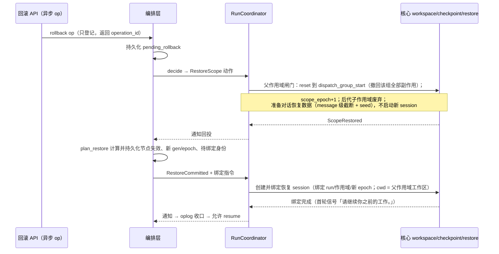

# traceback 工作区隔离与统一回滚技术规格（git worktree 写者作用域树）

> 本规格是 [ADR-0001](../adr/0001-worktree-scope-tree-unified-rollback.md) 的协议全文，已于 2026-11-24 冻结（S0a 三轮评审落档）；修改须先走设计评审。方案选型理由与被否决方案见 ADR，本文不重复。前置阅读：[RSI 在线时长修复闭环规格](rsi-online-repair-loop.md)；本文只定义闭环中「回滚」的文件态实现与归属模型。

## 1. 需求与术语

### 1.1 两级回溯与运行形态

| 级别 | 含义 | 恢复位置 | 触发者 |
|---|---|---|---|
| **节点级回溯** | 废弃该节点本轮作用域，在**当前集成头**重启该节点（redo on latest integration head：新 attempt 包含目标运行期间兄弟已集成的成果，不宣称精确回到节点开始前的集成基线），并按编排规则重置其后失效的任务 | 节点作用域 `scope_start` 检查点 | RSI 修复闭环、用户在 Web 手动触发 |
| **子代理级回溯** | 回退到所属 **dispatch_group 组检查点**之前（文件与对话同点），恢复父对话上下文后重新派发 | 父作用域 `dispatch_group_start` 组检查点 | RSI 修复闭环（`fault.subagent_timeout`）、用户手动 |

| 运行形态 | 节点级回滚 | 子代理级回滚 |
|---|---|---|
| Graph Run | **必须** | **必须**（节点 session 内）；两级同一套回滚 API，一次请求只产生一个新代次/epoch |
| 独立单 session | 不适用（无节点概念） | **必须**（含终态检查点，沿用现有重放语义） |

两种形态共用同一套文件态技术路线：单 session 同样可能并行派发写文件的子代理。

### 1.2 术语

| 术语 | 含义 |
|---|---|
| 作用域（scope） | 「集成根 → 主写者 → 子代理」执行树上的节点；核心对编排层概念的唯一抽象 |
| 集成根 / 主写者 / 子代理作用域 | Graph Run 集成线根 / 节点 executor、单 session 主 agent、bash 进程节点 / 主写者的直接子代理（默认 writer，可声明 reader） |
| 集成线（integration line） | 集成根的分支；只接收验收通过的合并，始终绿色 |
| scope epoch / root epoch | 作用域自身代次（回退/废弃递增）/ 集成线代次（集成线回退时递增）；两者独立 |
| 写入闸门（write gate） | 单作用域内的局部写入静止协议（§3.2） |
| 检查点（checkpoint） | 可回滚恢复点：作用域文件态引用 + 可选对话恢复锚点 + 编排状态引用 |
| `dispatch_anchor` / 派发屏障 | pre-dispatch 屏障内的对话恢复锚点（§7）/ 子代理真正创建前的同步生命周期点（§10） |
| snapshot 兼容模式 | 整目录快照的显式产品模式，仅用于历史数据读取与离线导入（`plugins/agent_traceback/snapshot_engine.py`） |

### 1.3 硬性约束

- 回滚 API 幂等：客户端操作 ID + 预期 epoch 校验；重复请求返回原结果，旧请求拒绝。
- 未开启 traceback 或无有效检查点时明确拒绝文件回滚。
- 恢复后的 session 仍归属原 Run、原节点、新代次。
- 遵守 G.CLS.11：不用 `getattr` 等字符串形态访问受保护成员。
- fail-fast（D2）：无法建立安全隔离时显式失败，不自动降级。
- 架构门禁：`plugins.<name>` 禁止依赖 `core/driver/store/api/web`；核心禁止依赖具体插件；迁移期插件经 SDK 端口访问核心。

产品决策 D1–D9（统一作用域树、fail-fast、选择性保留、默认 writer、终态同步、单基线历史、双轨屏障、协作式隔离、冲突检测默认 `git_merge` 档）见 ADR-0001，本文直接引用。

## 2. 现状盘点与差距

**共享目录**：graph 插件 `driver/engine.py` 中全部成员出生都指向同一目录（7 处 `cwd=self._work_dir`），`WORK_DIR` 注入所有 session；并行节点、执行与验收、bash 子进程全部直接读写同一物理目录，框架层面无隔离、归属或冲突检测。

**agent_traceback 插件为「已跑完的单 session」设计**：

| 能力 | 现状 | 差距 |
|---|---|---|
| 文件态快照 | `SnapshotEngine`：rsync 镜像 → `git add -A --force` → commit；内部 git 状态经保留路径 `.workflow-controller-inner-git/` 镜像 | 无并发单元归属；保留路径机制可被私有仓布局复用（§5.2） |
| 打点时机 | SUBAGENT_START 拦截器 + `session_complete` 观察 | 屏障质量随 runtime 不同（§10） |
| 检查点账本 | `checkpoints` 表（`git_ref`/`main_part_id` 等） | 无作用域/epoch 字段；`main_part_id` 锚点在子代理运行后才形成，不能用于前置屏障 |
| 对话恢复 | message 级截断 + 复制整库 + seed + `start_session_with_resume` | 机制可复用，但 fork 模式脱离 Run 归属 |
| 失败语义 | best-effort | 与回滚强前提冲突 |

**可复用资产**：内部 git 保留路径机制、SubagentTracker、graph `driver/state.py` 与 `scheduler.py::plan_rollback` 账本原语、`api/run_api.py` 的 `driver/op` 通道、watchdog fault 词表（`watchdog/fault.py`）、FileChangeCapture 与 `file_provenance`（不在删除范围）、`SessionConfig.cwd`/`env_overrides` 注入点、插件的 SnapshotEngine/CheckpointStore/l2_reader/seed 链路（迁入安排见 §13）。

## 3. 统一模型：写者执行作用域树

### 3.1 作用域树



统一规则：

1. **每个可能写文件的执行单元默认拥有独立工作区**（D4）；reader 子代理获得已发布 commit 的只读快照（§6.2）。
2. 子代理完成 → 在父作用域闸门内、结果交付前合并到父作用域（§3.2/§8.1）。
3. Graph 节点验收通过 → `awaiting_integration` → 集成成功才 `passed` 并解锁下游（§6.1）；单 session 主写者在 session 完成时集成到会话根。
4. 单 session 与 Graph 仅编排语义不同，文件隔离、检查点、对话恢复、回滚 API 完全共用。

单 session 可见性（D5）：主 agent 工作在托管工作区，运行期间原目录保持基线不变，经 live view 端点观察，完成后终态同步回原目录——这是**产品行为变更**。

**不变量**：

1. 单写者分支 + 闸门：每个分支同一时刻只有一个自由写者；协调器操作时该作用域必须闸门静止。
2. 串行集成 + 定序：验收通过 ≠ 集成完成。
3. 依赖可见性 = 集成历史：作用域基线 = 父作用域当时的头；并行兄弟互看不见未合并修改。
4. epoch 单调（两层）：旧 epoch 的回执、集成请求、回滚请求一律拒绝。
5. 检查点先于发布：文件态与编排状态引用都持久化成功后才可用。

**隔离强度（D8）**：协作式保证——在遵守 cwd/相对路径契约的执行者之间提供隔离与可归因，**不是对抗任意进程逃逸的安全沙箱**；配套 `file_provenance` 审计跨边界写、闸门与集成前对根检出 `git status` 对账。

### 3.2 作用域本地写入闸门

协调器不能对父 agent 正在写的脏工作区做路径扫描与 merge（扫描会过期、merge 与工具写入交错）；检查点 commit 也不能拍到后台进程的半写文件。闸门状态机（每个作用域独立）：



静止的三层来源（保证程度递减）：

| 层 | 机制 | 保证 |
|---|---|---|
| ① 会话静止 | 父 agent 对话停在 tool 调用上（等子代理结果/处于屏障回调内） | 结构性 |
| ② 同步工具排空 | 层①成立时父已发出的同步工具都已返回 | 结构性 |
| ③ 后台进程排空 | 父此前启动的后台/detached 写进程到达可暂停点，等待可配置窗口 | 尽力 + 声明 |

**闸门内操作序列**（子代理集成示例；检查点与恢复同序）：冻结父作用域 → 提交未提交修改、确认 clean → 校验 epoch/基线（§12）→ 路径集检测（§8.1）→ merge 更新父工作树 → 发布 → 解冻。

**子代理集成时机 = 结果交付前**：task result 交还父 agent 之前必须完成向父作用域的集成，否则父会根据结果继续行动却看不到子代理的文件。

**层③失败的降级规则**（等待有界，`background_drain_timeout_s`）：

- **父未阻塞在该结果上**（检查点、根集成、executor→verifier 交接等）：延迟到 join/终态边界；仍不可静止则 fail-fast（`fault.scope_quiesce_failed`）。
- **父正阻塞在 task result 上**（子代理集成）：**延迟不可用**（父等 result、result 等集成、集成等排空会形成等待环）——直接 `fault.scope_quiesce_failed`，task result 以 fault 收口，子代理按失败进入重试/回滚预算；仍无法静止则暂停 Run 等待处理。**绝不让父 agent 无限等待 task result。**

两种情况都不允许在活动脏工作区中直接合并。这是单作用域的局部静止，不依赖停掉整个 Run。

## 4. 量化 spike（前置）

进入大面积铺开前，用 fix-findings 真实目录测五项指标：初始基线导入耗时、单节点 worktree 检出耗时、`op/build` 纳入 checkpointed 后每次打点的提交耗时与磁盘增量、回滚恢复耗时、下游继承构建产物的成本。任一指标不可接受（如 GB 级产物频繁打点导致提交分钟级或磁盘翻倍）时，该类路径改 `rebuildable` 或评估内容寻址产物仓 / reflink·CoW 副本，**不强制全部纳入 Git**；结论回填 ADR-0001 备注。

## 5. 核心架构

### 5.1 组件与职责边界



职责边界：**核心只认识作用域**；节点、验收、代次、DAG 留在 Graph 插件内。RunDriver 契约保持：驱动纯决策（同步方法、world/notifications 只读），一切 I/O 经动作交宿主执行、结果经通知回投，context 对核心不透明。

### 5.2 通用动作 / 通知协议

| 动作（编排层 → 核心，经宿主执行） | 语义 | 通知（核心 → 编排层） |
|---|---|---|
| `PrepareScopeWorkspace(parent_scope, scope_key, spec)` | 闸门确认父静止 → 从父当前头建子工作区（含物化） | `ScopeWorkspacePrepared(scope_id, scope_epoch, base_commit)` |
| `IntegrateScope(scope_id, receipt)` | 父闸门内串行集成；预检不过发 `fault.workspace_conflict`，集成不发生 | `ScopeIntegrated(...)` / `ScopeIntegrationRejected(...)` |
| `RestoreScope(scope_id, checkpoint_id, client_op_id, expected_epoch)` | 闸门内把作用域文件态恢复到检查点（§9.2 集成线回退、§9.3 子代理组检查点恢复；可选附对话恢复）；epoch 不符拒绝 | `ScopeRestored(scope_id, new_scope_epoch, root_epoch)` |
| `AbandonScope(scope_id)` | 废弃作用域及后代工作区，scope epoch+1（§9.1 未合并回滚的废弃步；§9.2 失效传播） | `ScopeAbandoned(scope_id, new_scope_epoch)` |
| `RestoreCommitted(scope_id)` | 编排层确认失效计划已持久化——此前核心不得重建工作区/创建绑定恢复 session（§9.1/§9.3 定序保证） | 无独立通知；紧随的 `PrepareScopeWorkspace`/绑定动作回执即确认 |
| （检查点由核心在生命周期点自动打） | `scope_start` / `before_child` / `terminal` | `CheckpointRecorded(scope_id, checkpoint_id)` |

动作用法分工：未合并回滚（§9.1）= `AbandonScope` →（编排层持久化失效计划）`RestoreCommitted` → `PrepareScopeWorkspace`；已合并回滚（§9.2）= `RestoreScope`（根，集成线回退）+ 逐失效作用域 `AbandonScope`；子代理回滚（§9.3）= `RestoreScope`（父作用域，组检查点）→ `RestoreCommitted` → 创建并绑定恢复 session。

屏障请求是另一个入口：Session host 经 RunCoordinator（Graph）或会话宿主（单 session）发起（§10.2），同样遵守「协调器/宿主是唯一 I/O 手」。

Graph 映射（住在 graph 插件内）：executor 出生 → `PrepareScopeWorkspace`（含 `inherit_from` 解析）；verifier 通过 → `IntegrateScope`；未合并回滚 → `AbandonScope` →（失效计划持久化）`RestoreCommitted` → `PrepareScopeWorkspace`（当前集成头）+ Graph 失效计划；子代理回滚 → `RestoreScope(dispatch_group_start)` + 对话恢复 + 重新绑定；驱动状态快照 → 不透明 `orchestration_state_ref`。

### 5.3 模块清单

| 模块 | 路径 | 职责 | 来源 |
|---|---|---|---|
| ScopeTree | `core/workspace/scope_tree.py` 新增 | 作用域树账本（两层 epoch、闸门状态、不透明编排引用） | 新写 |
| WorkspaceManager | `core/workspace/manager.py` 新增 | worktree 生命周期编排、物化、GC（git 调用经 Repository，不直接拼 git 命令） | 新写 |
| Gate | `core/workspace/gate.py` 新增 | 闸门状态机 | 新写 |
| Repository | `core/workspace/repository.py` 新增 | 私有仓、基线导入、首层物化与 `scope_base_commit`；**git 子进程出口之一**（仓布局/worktree/提交/refs/核验） | 自 SnapshotEngine 提炼 |
| IntegrationCoordinator | `core/workspace/integration.py` 新增 | 集成线、串行集成、按路径集成树、两档冲突检测（§8.1）、集成线回退；**git 子进程出口之二**（diff/merge-tree/集成树） | 新写 |
| Manifest | `core/workspace/manifest.py` 新增 | 两维路径策略、物化/重建脚本登记、`inherit_from` 绑定 | 新写 |
| oplog | `core/workspace/oplog.py` 新增 | 持久化操作状态机（§11）；**横切 saga 记账**——跨 workspace/checkpoint/restore 的多步操作（含会话替换、检查点落账）均经此记账；留在 workspace/ 因 PREPARED/GIT_WRITTEN 阶段强绑 Git 提交 | 新写 |
| CheckpointStore | `core/checkpoints.py` 迁移（平铺单文件，对偶 `core/runs.py`，避免与顶层 `store/` 包重名） | 检查点账本（新表 `scope_checkpoints`，与插件旧 `checkpoints` 表并存至 P5，§7）；schema 经 RunStore 统一迁移管理；P5.2 兼容读取器平铺 `core/checkpoint_compat.py` | 插件迁移 |
| ConversationRestorer | `core/restore/` 迁移提炼（过渡期可先平铺 `core/conversation_restore.py`，P5.2 吸收 `session_reconstructor/` 时升包） | **只做对话态重建编排**：message 级截断、seed、`start_session_with_resume` + Run/作用域/epoch 绑定；L2 读取经 `transcript/`、会话创建经 `session/`，不自行实现 | 插件迁移 |
| SnapshotEngine | 暂留 `plugins/agent_traceback/`，最后随插件一起退役 | 兼容模式与历史快照读取 | 插件保留 |
| 派发屏障 | 驱动层 `DriverHooks` 扩展 | `before_subagent_dispatch`（§10） | 新增契约 |
| Graph 集成 | graph 插件 `driver/engine.py` 修改 | cwd 注入、映射表、异步回滚 op | 修改 |
| Web 端点 | 内核 `api/run_api.py` 扩展（CoreAPI 方法）+ 控制台发行包路由装配（`web/routes/runs_routes.py` 住控制台仓，不在本仓） | 异步回滚 op、作用域/检查点查询 | 内核修改 + 控制台仓 PR |

**git 子进程出口收敛**：git CLI 调用只允许出现在 `repository.py` 与 `integration.py`，其余模块（manager/gate/scope_tree/manifest/oplog）经二者 API；由 `tests/architecture/` 的 grep 型架构测试强制（plan §4.2）。

### 5.4 私有仓、根检出与内部 Git 状态

普通 worktree 需在根目录放 `.git` 指针，与保留用户 `.git` 冲突；Git 也不能把 `.git` 当普通内容导入。规则：

| 项 | 规则 |
|---|---|
| 私有仓 | `<root>/.workflow-controller/scopes/<run_id 或 session_id>/repo.git`：独立对象库与 refs；`core.hooksPath` 置空 |
| 根检出 | **不用 worktree**：以 `GIT_DIR=<repo.git> GIT_WORK_TREE=<root>` 分离环境操作；根目录不出现任何 OpsBot git 元数据 |
| 子作用域工作区 | 标准 `git worktree add`（`.git` 指针在托管目录树内） |
| 基线提交 | 全量导入工作树实际状态：脏文件 + 未跟踪文件 + 用户内部 git 状态（`.git` → `.workflow-controller-inner-git/` 保留路径镜像，独立趟、不受 ignore 约束）；排除私有仓/工作区/快照目录自身 |
| 用户仓 | 完全不被修改（分支、HEAD、index、stash、hooks） |
| 历史视图（D6） | 默认单基线提交；可选 `history_import: readonly` 把原仓 refs/objects 只读导入 `import/original/*` |
| 核心表 schema | 经 RunStore 统一迁移管理，不各建表 |

**内部 Git 状态的恢复按目标分三种**（现有 `_restore_inner_git` 先 rmtree 再改名的做法会摧毁托管 worktree 的 `.git` 指针，不可用）：

| 恢复目标 | 处理 |
|---|---|
| 托管作用域 worktree / 根检出 | 保留托管 `.git` 指针；原项目 git 状态只作为保留路径下的基线内容存在 |
| 离线导出、兼容重放 fork（snapshot 兼容模式） | 可把保留路径恢复成真实 `.git`（仅限该模式） |
| 单 session 终态同步回原目录（D5） | 默认不改原 `.git`；保留路径不参与同步 |

### 5.5 工作区物理布局

```text
$WORK_DIR/（Graph）/ <session cwd>/（单 session）
├── .git/                            # 用户自己的仓：只读保留路径导入，不改
├── design/ op/ dev-package/ ...     # 根检出
└── .workflow-controller/
    ├── snapshots/                   # snapshot 兼容模式（历史数据）
    └── scopes/<run_id 或 session_id>/
        ├── repo.git/                # 私有仓
        ├── root/                    # 单 session 终态检出（Graph 根检出直接用 $WORK_DIR）
        └── workspaces/<转义作用域键>/  # 作用域工作区
```

不用 /tmp：容量、重启清理与误删风险；生命周期与 Run/session 绑定统一 GC；可配置替代根目录。

作用域键进入私有仓分支名（`scope/<转义作用域键>`，含换代后缀 `-e<代次>`）与工作区目录名时统一转义：仅字母、数字、`_`、`-` 原样保留，其余字符按 UTF-8 逐字节编码为 `%XX`（`%` 自身亦转义）。运行时子图节点 ID 形如 `parent:child`，冒号对 Git 分支名为非法字符，转义后分支名恒合法；键本身含 `%XX` 字样时经 `%` 转义不会与被转义键碰撞。作用域账本、检查点行与编排引用一律保存原始作用域键，转义只发生在作用域键映射为分支名与目录名的边界。

## 6. 作用域生命周期与路径策略

### 6.1 生命周期与集成定序



要点：

1. 验收通过与集成分离：verifier 通过只进入 `awaiting_integration`；集成成功才 `passed`；冲突时节点未通过。
2. **executor → verifier 交接必须过闸门**：executor 完成 → 闸门静止并提交 terminal 执行态 commit → verifier 启动 → 验收通过 → `awaiting_integration`，否则 verifier 可能验收仍在变化的文件。两者共用节点作用域工作区；验收失败重试优先复用工作区。
3. 集成线始终绿色。
4. 所有工作区/集成/回滚操作由 RunCoordinator（Graph）或会话宿主（单 session）串行执行，先过闸门。
5. `AbandonScope` 对已 `released`（工作树已 prune）的作用域只做账面废弃 + scope epoch+1，重建走 `Preparing` 重新检出——验收失败回滚的目标必已集成、默认已释放（§9），这条迁移是常态路径而非边角。

### 6.2 路径策略：集成策略 × 回滚策略

两个正交维度，在 workflow YAML `traceback.workspace.manifest` 声明（未声明取默认）：

| 集成策略 | 含义 | 默认 |
|---|---|---|
| `merge` | 进基线、参与冲突检测、集成时 diff 应用到父树 | 默认全部（除下列三类） |
| `writer_local` | 不进集成线；每工作区自建 | `build/`、`dist/`、`__pycache__/`、`*.log` 等 |
| `shared_readonly` | 共享只读（仅文件系统/沙箱能强制只读时是硬保证，否则为审计约定，严格模式拒绝该配置） | 空；显式声明 |
| `shared_exclusive` | 共享独占租约（§8.2） | 空；显式声明 |

| 回滚策略 | 含义 | 要求 |
|---|---|---|
| `checkpointed` | 随检查点 commit 流动，恢复即精确恢复 | `merge` 类默认即此 |
| `rebuildable` | 确定性脚本重建 | 必须有脚本 + 验收；缺则退回 `checkpointed` |
| `external` | 不在恢复范围 | 固定脚本重建核对 |

**存储与恢复算法核心规则：每个作用域的检查点 commit 捕获全部 `checkpointed` 路径；集成时只把 `merge` 路径的 diff 应用到父树。**

| 组合 | 进检查点 commit | 进父集成线 | 建区时继承 | 回滚恢复 |
|---|---|---|---|---|
| `merge` + `checkpointed`（默认） | ✓ | ✓（diff 应用） | 随基线检出 | reset + checkout 作用域分支 |
| `writer_local` + `checkpointed` | ✓（`git add -f` 绕过 ignore） | ✗ | 从父作用域当前 commit 物化；首层从 `root_seed_checkpoint` 物化 | reset + checkout（含这些路径） |
| `writer_local` + `rebuildable` | ✗ | ✗ | 留空，执行重建脚本 | 重跑重建脚本 |
| `shared_*` / `external` | ✗ | ✗ | 符号链接 / 不处理 | 租约回收 + 外部重建协议 |

集成用**按路径构造集成树**：`git diff integration_base_commit..head -- <merge 路径集>` 生成补丁，在父闸门内应用到父树并提交；路径集相交时按 §8.1 档位处理（`git_merge` 档对相交路径取 merge-tree 三方合并结果入集成树，`strict` 档已在冲突检测拒绝、到不了本步）；`writer_local + checkpointed` 路径永远留在作用域分支与检查点里，不进集成 diff。

**作用域的两个基线字段**（职责严格分离）：

- `scope_base_commit`：作用域分支起点（首层 = integration parent + 物化 writer_local）——只用于文件恢复（`scope_start`）与子作用域建区继承。
- `integration_base_commit`：建区时父集成头——用于集成 diff、路径集冲突检测（§8.1）、已合并回滚的根 reset 目标（§9.3）。

误用后果：若用 `scope_base_commit` 做冲突基准，其包含的物化产物会被 diff 算成父侧删除，writer 一修改 `op/build/x` 即误报 `fault.workspace_conflict`（fix-findings 首期即触发）。

**根的两个引用**：`root_seed_checkpoint`（原目录完整初始状态，含全部 checkpointed 路径，不可变）与 `root_integration_head`（merge 路径集成状态）。首层写者建区：检出自 `root_integration_head` → `writer_local + checkpointed` 路径从 seed 物化 → 物化结果先提交为 `scope_base_commit` → 发布 `scope_start` → 才允许 executor 启动（物化后工作树必然不同于集成头，不能拿集成头当检查点）。非首层子作用域从父作用域当前 commit 物化。本地缓存跨作用域共享必须显式选择：重建（`rebuildable`）、指定上游复制（`inherit_from`）或提升为根种子；**不得默认从集成头获得**。

**`inherit_from` 定义**（声明分两层，静态 YAML 不含运行时 ID）：

- 逻辑声明层（YAML）：`inherit_from: {producer_node: upstream-build, checkpoint: terminal}`——节点 id + 检查点类型（`scope_start`/`terminal`）。
- 运行时解析层（Graph 插件，`PrepareScopeWorkspace` 之前）：解析为精确三元组 `{producer_scope_id, producer_scope_epoch, checkpoint_id}`；上游已回滚/废弃时**解析拒绝**，下游不获得失效产物；解析结果随请求记账，可审计。
- 绑定：核心只接受精确三元组（不理解 Graph 概念）；生产者后续推进不改变已物化副本。
- 保留：上游释放后下游副本不受影响；需要「最新终态」须重新声明绑定。
- 失效：上游回滚且被判定级联失效时，编排层按绑定记录向下游发失效，下游基于失效产物的通过结果一并重置；账上找不到绑定记录的物化副本按审计告警处理。
- 组合：多上游须显式列出全部绑定且各 merge 路径集与物化路径集两两不相交，相交即拒绝建区；**第一版只做单上游绑定**。
- 动态 manifest：由接入层运行期生成时，生成者与生成时机须记录并可审计。

铁律：**凡标记 `rebuildable` 而无法给出确定性脚本与验收的路径，一律按 `checkpointed` 处理。**

fix-findings 落点：`op/build/**` 为 `writer_local + rebuildable`，重建脚本必须确定性并经验收；RSI 隔离测试 Run 复现旧版时无法保证同口径重建则显式改 `writer_local + checkpointed`。

**reader 子代理**：不共享父工作树，获得某个已发布 commit 的 detached worktree / 只读快照（默认父作用域最近检查点 commit）；无分支、永不集成；其写入不构成保证（严格模式由只读挂载/沙箱强制，做不到则只作审计约定并告警）。

### 6.3 检查点类型与持久化顺序

| 检查点 | 打点时机 | 内容 |
|---|---|---|
| `scope_start` | 主写者作用域建立时（闸门确认父静止后） | 基线 commit（首层 = `scope_base_commit`）+ 已持久化的编排状态版本引用 + 对话起点 |
| `before_child` | 派发屏障内（§10.2） | 组检查点 `dispatch_group_start` commit + `dispatch_anchor` + 编排状态版本引用 + 组内子作用域身份 |
| `terminal` | session 完成时（闸门内） | 终态 commit；单 session 主写者此时集成到会话根 |

**持久化顺序（反了文件与编排状态会错位）**：① 编排层状态版本先持久化（Graph：PersistDriverState；单 session：会话账本）→ ② 核心（闸门内）提交文件态 commit → ③ 检查点行记录①② → ④ 发布（此时才可用于回滚）。

`before_child` 的精确性以屏障能力为前提：runtime 无前置屏障时严格模式不提供子代理级回滚（fail-closed），compat 模式显式标注 `late_barrier`、保证弱化。

## 7. 数据模型

核心新建 `scope_checkpoints` 表（schema 经 RunStore 统一迁移管理）。**与插件旧 `checkpoints` 表并存至 P5**：旧表由插件以旧列集继续读写、零改动（「旧单 session 与插件路径 P5 前不动」的硬约束）——核心新列均 NOT NULL 无默认值，若加进旧表，插件并存期的旧形态 `INSERT` 会撞约束失败，且 SQLite `ALTER TABLE ADD COLUMN NOT NULL` 必须带默认值，同表迁移在并存期不成立；P5 插件删除后旧表仅经兼容读取器访问：

```sql
CREATE TABLE IF NOT EXISTS scope_checkpoints (
    checkpoint_id    TEXT PRIMARY KEY,
    scope_id         TEXT NOT NULL,       -- 核心唯一理解的归属
    scope_kind       TEXT NOT NULL,       -- root | main_writer | subagent
    parent_scope_id  TEXT,
    scope_epoch      INTEGER NOT NULL,
    root_epoch       INTEGER NOT NULL,
    trigger          TEXT NOT NULL,       -- scope_start | before_child | terminal
    barrier_quality  TEXT NOT NULL,       -- precise | late_barrier
    workspace_branch TEXT,
    workspace_commit TEXT,
    integration_commit TEXT,              -- 建点时父作用域头（子代理 = child_base_commit；
                                         --   首层 scope_start = integration_base_commit；
                                         --   已合并回滚的根 reset 目标）
    dispatch_anchor  TEXT,                -- JSON: {parent_native_session_id, parent_message_id,
                                        --        tool_use_id, preallocated_scope_id,
                                        --        exclude_message_id, dispatch_group_id}
    child_session_map TEXT,               -- JSON: {scope_id -> native_child_session_id}，启动后回填
    claims           TEXT,                -- JSON: 声明写路径 glob（§8.3）
    orchestration_state_ref TEXT,         -- 不透明编排状态引用，核心仅存不解析
    created_at TEXT NOT NULL,
    file_count INTEGER DEFAULT 0, byte_size INTEGER DEFAULT 0,
    status TEXT DEFAULT 'ok'
);
```

`dispatch_anchor`：现有插件的 `main_part_id` 锚点是子代理运行后才形成的，前置屏障里子 session 尚不存在，故锚点改为派发时即可形成的六元组，子代理启动后由 `child_session_map` 回填；旧 `main_part_id` 仅作历史检查点兼容格式。

**截断必须是 message 级**：恢复时丢弃 `exclude_message_id` 所指 message 的全部 part 及其后内容（part 级截断会留下「我将调用 X」孤儿文本）；当前 message 未完整持久化时锚点保存上一个完整 message 边界；同一 message 的多个 task 调用共用一个恢复边界。

**dispatch_group：文件恢复点与对话边界必须表示同一逻辑时刻（硬不变量）**。message 级截断丢弃整个 message（含同 message 更早的 task A 与写文件工具调用）；若文件只恢复到 B 的 `before_child`，A 的修改留在文件、A 的记录从对话消失，续跑可能重跑 A 造成重复副作用。规则：

- message 内**第一个可产生副作用的工具调用（含 task 与写文件工具）之前**建立组检查点 `dispatch_group_start`；同组全部副作用共享该文件恢复点与对话边界；回滚组内任一 task = reset 到组检查点，同组全部副作用一并撤回重跑。
- **组恢复点不可变、子基线可前进**：`dispatch_group_start.commit` 创建后不再移动；组内后续派发只产生 `child_base_commit`（可含组内前序成果），用于该子建区与 saga 补账，不作为恢复目标。
- **组仲裁依赖能力 ⑤**（§10.3）：仅有 task 前置屏障时，「写文件工具 → task」顺序下组检查点会落在写副作用之后——此时按能力缺失 fail-closed。
- 严格模式可选强化 `one_side_effect_per_message`（默认关闭，强制执行同样依赖 ⑤）。
- 兼容读取：无组信息的旧检查点按「组 = 该 message」处理。

`scopes` 表：

```sql
CREATE TABLE IF NOT EXISTS scopes (
    scope_id      TEXT PRIMARY KEY,
    parent_scope_id TEXT,
    scope_kind    TEXT NOT NULL,          -- root | main_writer | subagent
    workspace_ref TEXT,                   -- worktree 路径 + 分支 ref
    scope_base_commit TEXT,               -- 文件恢复 / 子作用域建区继承
    integration_base_commit TEXT,         -- 集成 diff / 路径集冲突检测 / 根 reset 目标；
                                         --   子代理场景 = 其 child_base_commit
    scope_epoch   INTEGER NOT NULL,       -- 作用域代次（回退/废弃递增）
    root_epoch    INTEGER NOT NULL,       -- 建区时集成线 epoch（判断基线是否失效）
    gate_state    TEXT NOT NULL,          -- running | quiescing | quiesced
    state         TEXT NOT NULL,          -- preparing/active/awaiting_integration/
                                        -- integrated/conflicted/discarded/released
    owner_ref     TEXT,                   -- 不透明：编排层执行单元标识
    created_at    TEXT NOT NULL
);
```

`scope_epoch` 标识「这个作用域的第几代实例」，旧回执按 `(scope_id, scope_epoch)` 拒绝；`root_epoch` 只在集成线回退时递增，拒绝基于失效基线的集成与回滚请求。回滚请求的 `expected_epoch` 按操作对象取对应层。

## 8. 冲突检测：默认可合并性为准，strict 档按路径集重叠

### 8.1 硬保证：两档判定（闸门内执行）

冲突判定由配置项 `traceback.workspace.conflict_policy` 选档（§15），按集成根生效：

- `git_merge`（默认）：以 Git 三方合并结果为准——同一 merge 路径被双方修改、但合并干净（hunk 不相交，如一方改文件上半、另一方改下半）即放行；只有真实合并冲突才发 `fault.workspace_conflict`。
- `strict`：路径集重叠即违规——任何两个并发写者改同一 merge 路径（无论 Git 能否自动合并）都拒绝，适用于「并发单元不得改同一文件」需硬保证的场景。

判定（全部在父作用域闸门内，扫描与 merge 之间无竞态）：

```text
[闸门] 冻结父作用域 → 提交父未提交修改（parent_head 前进到工作树实际状态）→ 确认 clean
R = 本作用域的 integration_base_commit（不是含物化产物的 scope_base_commit）
writer_paths = pathset(diff(R, writer_head))  ∩ merge 路径集
parent_paths = pathset(diff(R, parent_head))  ∩ merge 路径集
overlap = writer_paths ∩ parent_paths
overlap = ∅            → 按路径构造集成树（base = R）应用 merge 路径 diff → 发布 → 解冻
overlap ≠ ∅ 且 strict  → fault.workspace_conflict（集成不发生）
overlap ≠ ∅ 且 git_merge → 对 overlap 路径做三方合并（git merge-tree，base = R）：
    合并干净 → 合并结果随集成树一并提交 → 发布 → 解冻
    合并冲突 → fault.workspace_conflict（集成不发生）
```

同一公式覆盖三个冲突来源：并行子代理互撞（parent_paths 含先到者已合入的 diff）；父后台写入与子代理撞（闸门内落账的父写入）；Graph 并行节点撞（节点集成时 parent_paths = 建区时 root_integration_head 之后的集成线变化）。

`strict` 档必须覆盖的路径事件（路径出现于双侧变更集即命中，全部拒绝）：modify/modify（即使 hunk 不重叠、Git 可自动合并）、add/add（即使内容相同）、delete/modify、delete/delete 后重建、rename（按旧删+新增计）、目录/文件替换、symlink 与普通文件互换、类型/模式变化。

`git_merge` 档下同一事件集由 merge-tree 判定：modify/modify 不相交 hunk 放行、相交即冲突；add/add 内容相同放行、不同即冲突；delete/modify、delete/delete 后重建、rename 交叉、目录/文件替换、symlink 与普通文件互换、类型/模式变化等 Git 判冲突的事件照常拒绝。

`git merge-tree` 的角色随档位变化：`git_merge` 档它是「同文件是否冲突」的判定器与合并内容生成器；`strict` 档它只在路径集预检通过后作可合并性检查，不承担「是否同文件」判定。符号链接目标内容的修改不经过任何 writer 的 git diff，共享路径靠 §8.2 强制手段。

fault payload：冲突路径、双方身份、双侧 commit、共同基线（`git_merge` 档冲突路径以 merge-tree 报告为准）。冲突策略：`fail_unit`（执行单元 failed，进重试/回滚预算）或 `pause_for_repair`（Run 暂停等修复）。

### 8.2 共享路径

- `shared_readonly`：仅文件系统/沙箱能强制只读时是硬保证；只能标注为审计约定时严格模式拒绝该配置。
- `shared_exclusive`：协调器授予/回收独占租约，请求冲突即拒绝并行执行。
- 内容哈希仅作审计证据（`file_provenance`），不承担多写者识别。

### 8.3 软预检：claims

```yaml
nodes:
  - id: kernel-bringup
    writes: ["op/op_kernel/**", "op/build/autogen/**"]
```

单元出生/派发时登记 claims。`claims.enforce` 与 `conflict_policy` 正交，组合语义写死：

| | `git_merge`（默认） | `strict` |
|---|---|---|
| `claims.enforce: false`（默认） | 只登记；集成时 merge-tree 判定 | 只登记；集成时路径集判定 |
| `claims.enforce: true` | 出生期 claims 相交即拒绝第二个单元出生（事件 `workspace.claim_rejected`，显式开启的硬预检）；集成时仍 merge-tree 判定 | 出生期拒绝 + 集成时路径集判定（最严组合） |

声明与实际不符不阻塞——§8.1 判定兜底，`file_provenance` 事后核对记审计事件。不声明 `writes` 的单元只受 §8.1 判定约束。

### 8.4 与 RSI 闭环的衔接

`fault.workspace_conflict` 与 `fault.scope_quiesce_failed` 进 watchdog 开放词表；RSI 适配器把它们与 `fault.node_timeout` 同级映射为停止信号；诊断证据里的 merge-path diff 即「谁改了什么」。

## 9. 回滚语义：统一异步确认链

> 节点回滚与子代理回滚由同一组核心动作（`AbandonScope`/`RestoreScope`/`PrepareScopeWorkspace`）经同一条异步动作/通知确认链完成，区别仅在于选哪些动作、恢复哪个检查点、是否恢复对话、编排层附加什么失效动作。

| 回滚类型 | 统一操作 | 编排层附加动作 |
|---|---|---|
| 节点回滚（未合并） | 废弃目标作用域及后代 + 在当前 `root_integration_head` 重建（redo on latest integration head），目标 scope epoch+1 | Graph：目标节点回 pending、gen+1（reset 集 = `descendants(target) ∪ {target}`；验收失败回滚另含 `failed_node`；target 为动态子图节点时另含父 generator，特例见 §9.1.1）；失效集外作用域零变化 |
| 节点回滚（已合并） | 集成线回退到目标检查点的 `integration_commit`（**不得用 `scope_base_commit`**）+ 保留者按原集成序换序重放 + root epoch+1 | Graph：基线谱系含目标集成提交的作用域失效重跑、不含的保留不重跑（选择性保留，D3，§9.2.1） |
| Graph 内子代理回滚 | `RestoreScope(node_scope, dispatch_group_start)` + 截断父对话 | Graph：目标节点原验收失效，重绑新 executor/epoch |
| 单 session 子代理回滚 | 同上（父作用域 = 主 agent 作用域） | 无 DAG，替换当前执行代次 |
| 批量节点回滚（§9.4） | 集成线回退（含已合并目标时）+ 逐目标 `AbandonScope` + 重建，单 operation 整体推进 | Graph：受理原子校验与重叠归并、统一失效计划、全部目标共用单一新回滚代 |

**验收失败回滚的目标必已集成**：`rollback_to` 被校验为失败节点的严格祖先，而 §6.1 下祖先 `passed` ⟺ 集成成功。因此验收失败回滚一律按上表「未合并」行（§9.1）的编排语义执行——废弃目标作用域及后代、在当前集成头重建，目标既有集成成果保留在集成线、不做文件撤回（与改造前共享目录行为一致，§9.1.1 对 generator 的处理即此通则的特例化）；§9.2 的集成线回退只服务显式的已合并回滚请求，不由验收失败回滚触发。**P4.3 之前显式请求命中已集成目标的一律明确拒绝**（回滚 API 返回「已合并回滚未实现」），不自动改按 §9.1 执行——§9.1 的语义由编排层的 rollback_to 机制触发，显式请求不做隐式分流。

请求参数：`scope_id` + `checkpoint_id` + `client_op_id` + `expected_epoch`。同一 `client_op_id` 重复请求返回原结果；**同键携带不同目标/检查点返回冲突错误**；`expected_epoch` 不匹配拒绝并返回当前 epoch。

### 9.1 未合并节点回滚：异步动作/通知状态机

**为什么不能同步**：`driver/op` 是同步驱动调用，链路有三级上界——Web/应答通道 `OP_REPLY_TIMEOUT_S=30s`（`core/run_coordinator.py`）→ 协调器 `_OP_DRIVER_WAIT_S=75s` → 驱动层 `OP_HANDLE_TIMEOUT_S=80s`（`plugin/run_driver.py`）；同步回滚会先撞 30s 应答上界，且驱动契约要求同步方法纯决策。



关键性质：

1. **严格局部**：只废弃目标作用域及其后代；失效集外作用域文件与状态零变化；集成线不动。新作用域从**当前**集成头重建——目标运行期间兄弟已集成的修改对新 attempt 可见（声明语义，验收 #25 固化）。
2. **scope epoch 递增**：旧 executor/子代理的迟到回执按 `(scope_id, scope_epoch)` 拒绝。
3. **幂等**：`client_op_id` + `expected_epoch`；崩溃后由 oplog 核对（§11）。
4. **职责分工**：核心做文件/作用域/epoch/对话恢复；Graph 在 `ScopeAbandoned` 后纯决策计算失效与新代。
5. **通用 `plan_restore(target, reason, expected_gen)`**：既有 `plan_rollback` 的前提是 `failed_node` 为 `failed` 且 gen 匹配（服务验收失败自动回滚）；手动回滚、超时后 stopped 节点、子代理回滚都不满足——新函数承担全部回滚计划计算（reset 集、新代、回滚边、预算），既有 `plan_rollback` 成为其调用方之一；`expected_gen` 不匹配返回 None。`plan_restore` 必须保留动态子图特例（§9.1.1）。

### 9.1.1 动态子图（generator）目标的回滚特例

动态子图是架构层已确认的现实（`docs/ARCHITECTURE.md` 崩溃恢复：「子图节点按归档代恢复」；graph 插件 `driver/scheduler.py::plan_rollback`/`apply_rollback` 已实现本特例，`plan_restore` 必须原样保留，否则按 §9.1 公式字面实现会把 generator 一并打回 pending、触发子图重新生成——语义错误）。

**适用条件**：target 是动态子图节点（`state.subgraph_parent(target)` 非空；归属按 `subgraph_node_ids` 显式判定，不靠节点 id 中的 `:` 推断）。

**语义**（与现码对齐）：

1. reset 集 = `descendants(target) ∪ {target}`，另加父 generator——generator 计入 reset 集并与其他节点共用同一新回滚代（`new_gen`），但**立即置回 `passed`：不重新编排、不重新生成子图**。
2. generator 已生成的子图**不废弃**（废弃清单排除 `parent_gen_node`）；reset 集中**其他** generator 节点的旧子图照常废弃（重新生成才能合并新拓扑）。
3. 回滚边记在 generator 上：`(parent_gen_node, old_parent_gen) → (parent_gen_node, new_gen)`，而不是默认的 `(failed_node, failed_gen) → (target, new_gen)`。
4. 主图下游（descendants 内）一起 reset；子图重跑通过后这些下游重新运行。

**作用域树映射**：generator 没有新 attempt——其作用域与已集成成果（含已合并子图节点的集成）保留，仅子图目标节点及其后代的作用域被废弃并从当前集成头重建。这与「未合并回滚不动集成线」一致：generator 的产物既已集成，自然包含在新基线中。

### 9.2 已合并节点回滚（选择性保留：换序重放，D3）

失效集按**基线谱系**计算而非线上位置：已集成写者的 `integration_base_commit` 祖先链含目标的集成提交 → 失效重跑；不含 → 保留，其集成 diff 按原集成序重放到回退后的线上（安全性论证与边界见 §9.2.1）。同一异步状态机，核心动作为 `RestoreScope`（根作用域，回退集成线到目标 `integration_commit`）+ 保留者重放 + 逐失效作用域 `AbandonScope`（**先校验后 reset，拒绝发生在任何改动之前**）：

```text
PREPARED(expected_root_head, expected_root_epoch)
→ [闸门] 暂停所有活动写者
→ 复核当前 root_integration_head / root_epoch 与 PREPARED 一致；不一致 → 停止并报告分叉
→ 校验 reset 目标（目标 scope_start 检查点记录的 integration_commit）：
  ① 已在宿主登记；② 属于当前集成线；③ 是当前 root_integration_head 的祖先；
  ④ 树内不含 writer_local 路径变更。任一不满足 → 停止报告分叉，绝不 reset
  （空集成目标免②–④：线上无集成提交可撤）
→ 计算失效集：谱系含目标集成提交的已集成作用域 + 基于失效基线的活动写者
→ reset 到该 integration_commit → 按原集成序重放保留者 diff（构造性干净，§9.2.1）
  → GIT_WRITTEN(actual_root_head) → root_epoch+1（线不动时不推进）
→ 失效集作用域废弃（scope_epoch+1）；保留者作用域不动
  （其分支/worktree/检查点引用自有分支提交，不受线提交重写影响）
→ ScopeRestored 通知 → Graph 失效集任务重跑、保留者不重跑 → 新代重建 → oplog 收口
```

旧 root epoch 的完成回执、集成请求、回滚请求一律拒绝（换序省的是重跑，不是代次纪律）。子代理修改已合并进父作用域后的回滚向上传播：组检查点恢复使父分支回退；若已集成到根，按本节语义继续传播。各路径策略按 §6.2 恢复（checkpointed 随检查点、rebuildable 重跑、shared_* 回收租约、external 脚本核对）。

**空集成作用域**（验收通过但未改动 merge 路径文件、集成线上没有集成提交）不阻塞回退，也不引入多余线动作：作为回退目标时无集成提交可撤——不参与回退点与谱系基准、免线位置与区间校验，直接进失效集废弃重建；目标集全部为空集成时回退点即当前集成头，线与根检出不动，root epoch 不推进（根代次只随线动：线不动时在途写者基线仍属当前代次，其集成照常受理，不因旧代次被拒）。作为保留者时线上无成果可重放，原样保留。保留者重放集为「最晚一条集成提交严格晚于回退点」的作用域——回退点之前的集成原样在线，不重放、不重复落提交；同作用域多次集成、回退点落在两次集成之间时按最晚一条判定（最早一条已不代表线上现状，撤下的是后一条）。空集成判定须以作用域分支对建区基线在集成路径上确无变更核对：分支仍带集成路径变更而线上无集成提交时显式拒绝，不静默按空集成跳过（提交信息前缀解析错位时真实改动不得留在线上）。

### 9.2.1 换序重放的安全性论证与边界

典型场景：并行写者 A、B 从同一基线 H0 各自建区，A 先过验收先集成；回滚已集成的 A 时保留 B——由于集成顺序本来就是任意串行化点（谁先过验收谁先集成），换序重放 B 是安全的。论证分三层：

1. **B 的被验证产物与 A 物理无关**：B 的 worktree 从 H0 检出，从未包含 A 的内容（可见性不变量：作用域只见建区时的树）；B 的 verifier 签收的就是 `H0 + diff(B)` 这个状态。
2. **重放后的线恰好就是 B 被验证的状态**：重建线 = reset 到 H0 → 应用 `diff(H0, B.head)`——diff 套在 B 自己的基线上必然干净（构造性，非运气），且结果树（merge 路径集）逐字节等于 B 的 worktree 终态，即当初验收通过的内容。
3. **收敛性**：A′ 从新头（含 B）重建后若改了与 B 相同的文件，集成时走 merge-tree 三方合并（base = A′ 的基线）——不相交 hunk 的三方合并内容可交换（先 A 后 B 与先 B 后 A 同结果）；不可交换的事件对（delete/modify、add/add 不同内容、类型/模式互换等）在第一遍 B 集成时已被 §8.1 两档冲突检测挡掉——能出现在已集成线里的组合都是可交换组合。

机械澄清：git 里「换序」不是移动提交对象（SHA 由父与内容决定，换父必换 SHA），实际为 reset 到 H0 + 重放 B 的 diff 生成新提交——B 的线提交 SHA 必变，`root_integration_head` 更新；B 自己的分支、worktree、检查点行不受任何影响（它们引用的是 B 自己的分支提交，不是线提交）。

边界（换序不适用 / 救不了）：

| 情形 | 说明 |
|---|---|
| 保留判据 | 不是「同 commit」，精确判据是「B 的基线谱系（`integration_base_commit`  ancestry）不含 A 的集成提交」；同基线只是特例 |
| B 的 DAG 下游 D（已跑） | D 建区晚于 A 集成 → 基线树含 A → 无法证明未消费过 A → 仍要重跑；换序只救基线谱系不含 A 的写者，不沿 DAG 往下传递 |
| root_epoch | 照样 +1：语义基线变了，旧 epoch 的回执/集成/回滚请求照旧拒绝——换序省的是重跑，不是代次纪律 |
| 多个保留者 | 按原集成顺序重放（顺序本身任意，取原序最忠实，冲突检查序列可复现） |
| B 尚未集成 | 不涉及换序——那是未合并回滚（§9.1），线不动，B 之后正常集成即可 |
| 语义纠缠但文本干净 | 不存在：B 的 worktree 里没有 A 的内容，B 不可能引用 A 新增的函数/文件；「文本干净但语义依赖 A」的状态在 B 的验证环境里组装不出来 |

schema 已就绪：谱系判据的数据源 `integration_base_commit` 已冻结在账本（§7），无需预留字段。

### 9.3 子代理级回滚（Graph 与单 session 共用）



**定序保证**：新 session 在编排层持久化失效状态（新 gen/epoch、待绑定身份）之前不得创建——否则中途崩溃会出现「新 session/旧节点状态/已恢复文件」三者不一致。核心 saga 先备好恢复数据，编排层确认 `RestoreCommitted` 后才创建并绑定；单 session 复用同一 saga，宿主自任编排确认方。

**失效范围**：恢复到组检查点撤回该点之后全部内容——父 agent 后续写入、组内及之后所有子代理/写文件工具的修改及其集成。已集成到更上层时按 §9.2 传播。

**恢复后的派发语义**：首轮信号提供**从检查点自然续跑**，不承诺确定性重派。需要确定性重跑同一子代理时启用 `replay_dispatch`（宿主在组检查点保存原始 task 调用参数，恢复时重放；默认关闭）。**replay_dispatch 仅允许单 task、无其他副作用的 dispatch group**——多副作用组回滚会撤回整组，只重放目标 task 会缺输入（如「A 生成输入 → B 消费」），请求时校验并明确拒绝；多副作用组用自然续跑。

已知边界：孙代理不打点，最小恢复粒度是直接子代派发前。

### 9.4 批量节点回滚（单请求多目标）

> 2026-11-25 增补（决策见 ADR-0001 补充决策 D10–D13）。一次回滚请求携带多个节点目标，未合并与已合并目标混合支持；受理原子、重叠自动归并、单 operation 整体追踪。子代理级目标不在批量范围：targets 的 `scope_id`/`checkpoint_id` 必须对应节点主写者作用域及其 `scope_start` 检查点，传入子代理作用域或 `before_child` 组检查点即拒绝（子代理回滚走 `rollback_subagent`）。

**请求形态**：`rollback_nodes` op——`targets: [{node_id, scope_id?, expected_epoch, checkpoint_id?}, ...]`、请求级 `expected_root_epoch`（含已合并目标时必填）、`client_op_id`、`reason`。幂等键仍为 `client_op_id`：同键重放返回原操作记录与当前状态；同键携带不同目标集或参数返回冲突错误（参数比较按原始请求，不做归并后比较）。已合并目标的 `checkpoint_id` 约束与单目标链一致：须为本作用域的 `scope_start` 行，缺省取 `{scope}:scope_start:e{epoch}`。

**受理面（全量校验，任一不合格整体拒绝、零改动）**：

1. traceback 未开启 → 拒绝。
2. 幂等重放检查先于一切在册性校验（对齐 §9.1）。
3. 每目标：节点存在；有在册作用域（无有效检查点拒绝）；`scope_id`/`expected_epoch` 与当前映射匹配；任一目标为 passed 时请求必须携带合法 `expected_root_epoch`。
4. 重叠归并（归并结果记操作记录 `merged_from`，可审计）：
   - 未合并目标间：`v ∈ descendants(u) ∪ {u}`（回滚祖先已隐含重置后代）→ v 归并入 u。
   - 跨桶 DAG 包含：已合并目标 `v ∈ descendants(u) ∪ {u}`（u 未合并）同样归并入 u——`run_on_failure` 下游可以在祖先 failed 时通过验收并集成，单目标回滚 u 的 reset 集本就含 v（§9.1），拒绝会造成「拆开多次单目标请求能成功、合成一次批量请求被拒」的语义倒退。归并的语义后果：v 从「已合并回退」（撤集成线）改判为「未合并编排语义」——其集成成果保留在集成线、随 u 的新 attempt 基线重跑（ADR-0001 D12；batch(u, v) ≡ rollback(u)，而非 rollback(u) + rollback_integrated(v)）。
   - 已合并目标间：目标 j 的建区基线谱系含目标 i 的集成提交（单回滚 i 时 j 本就在失效集）→ j 归并入 i 的随动失效。
   - 归并只处理包含关系；reset 集相交但互不包含（兄弟目标共享下游）合法，失效集取并集。
   - 受理面 handle_op 纯决策不做 git 谱系查询（且并发集成会使受理时的预测过期）：跨桶谱系吸收（未合并目标的基线谱系含某已合并目标的集成提交、将被回退连带失效）不在受理时预测，由回退回执的实际失效清单补记（见执行链）。
5. 归并后分类：已合并桶（passed）与未合并桶；显式目标全部被归并时按归并后集合照常执行。

**执行链（单 operation，相位整体推进）**：

```text
pending →（decide 推进，全量复核映射/代次/root epoch，任一目标已变化 → 整操作 failed，零改动）
→ retracting（已合并桶非空；无已合并桶时跳过本相位与谱系失效落账）：
  集成线回退到 T = 线上有集成提交的各已合并目标建区基线在首父链上的最早者
  （空集成目标不参与；目标集全部为空集成时 T 即当前集成头，线与根检出不动）；
  待撤回集 = 谱系归并后的已合并目标作用域；失效集 = {待撤回目标} ∪ 基线谱系含任一
  待撤回集成提交的写者（§9.2 先校验后 reset 与原子推进不变）
→ 回退回执当场落账谱系失效计划（通知消费段、先于本轮调度）：预分配共享 new_gen 记入
  操作记录、停失效节点在途会话、失效节点回 pending 并清工作区映射；回执实际失效清单中
  被连带失效的显式未合并目标补记 merged_from（其物理废弃已被回退完成、编排失效由
  本计划覆盖）；原计划过期（expected_gen 被他者回滚推进、计算返回 None）时仍按回执
  实际失效清单以新鲜代次落一次收口失效，随后操作置 failed——物理后果必须反映到编排
→ abandoning：对其余显式未合并目标逐个 AbandonScope（同轮发出、回执计数）
→ 每张 ScopeAbandoned 回执到达即落该目标的计划切片（回执增量落账；切片 reset 集 =
  该目标 plan_restore reset 集，扣除已落账节点；共用预分配 new_gen，单调性核验见下）
→ 最后一张切片落账后 RestoreCommitted
→ rebuilding：归并后全部显式目标达到「新工作区就绪 ∨ 编排终态化（skipped/failed）」→ succeeded
```

**回执即落账（与单目标链的对齐）**：单目标链的失效计划在回执的通知消费段落账、先于本轮调度，物理变更与编排失效之间没有调度轮次；批量链统一为「每张回执都有对应的编排落账，回执的实际清单是事实源」——回退回执当场落谱系失效计划，每张废弃回执当场落该目标切片。若等全部物理步骤完成才统一落账，回执与计划之间会插入拿着过期 GraphState 的调度轮（失效节点映射指向已删除作用域、在途会话无人停）；且部分物理成功、后续逻辑失败时，「作用域已物理废弃、编排从未失效」的目标会掉进缝里——其状态从未被 reset 成 pending，重试欠账清理（节点重新起步才触发）救不回它。**本原则不因操作终态而止**：同轮发出的废弃动作由协调器逐动作独立执行、互不因兄弟失败中止，其成功回执晚于操作置 failed 到达时仍按本节照常落账（含切片单调性核验）；操作终态只门控是否发起新动作与 rebuilding 判定，不门控回执落账。

**执行期逻辑失败（非崩溃）语义**：回退失败或被拒 → 零改动（§9.2 先校验后 reset），操作置 failed；回退成功后谱系失效计划落账过期 → 按回执实际失效清单以新鲜代次落收口失效，随后操作置 failed；某个废弃动作逻辑失败（如代次已被他者改变）→ 已落账切片不回撤（物理与编排一致）、失败目标保持原状（其作用域未被动过），操作置 failed 留因。任何分支都不留「物理先进、编排滞后」的半个现场——失败塌缩到最大一致前缀由回执增量落账自然成立。

**代次与记账**：预分配共享 new_gen 在谱系失效计划首次落账时分配（= 当时 `max_gen()+1`）并记入操作记录，后续切片复用；无已合并桶时不预分配，首张废弃回执的切片落账时新鲜分配。切片落账前做单调性核验（`reset_rollback` 无条件赋代，单调性由落账前核验保证，不依赖 store 侧守卫）：切片 reset 集内任一节点当前代次 ≥ 预分配代 → 不再使用预分配代——目标自身已被他者回滚推进（已 reset 到新代、映射已清）的切片跳过落账并记入操作记录（其编排失效已被他者计划覆盖、作用域已被本链物理废弃，两侧一致）；其余情形该切片以新鲜代次落账并在操作记录标注。**代次单调（§3.1 不变量 4）优先于「全部目标共用同一代」**。root epoch 随线动 +1（目标集全为空集成、线不动时不推进，在途写者基线仍属当前代次）；各失效作用域 scope epoch 各自 +1；回滚边与预算按各显式目标分别记（`(target, old_gen) → (target, new_gen)`，手动/超时回滚的触发节点即目标自身）。

**动态子图（generator）批量交互**（§9.1.1 特例的推广）：

- 批量失效计划的计算约定为「集合并 + 单代赋值」：先按 §9.1/§9.1.1 规则逐目标算 reset 集（含父 generator 归属）取并集，再统一赋共享 new_gen，不逐目标各自赋代；并发交错下的切片改代是单调性核验的例外（见上）。
- 同一 generator 下多个子图节点目标：父 generator 进 reset 集一次、共享 new_gen、编排后立即置回 passed、其子图不废弃；generator 上的回滚边只记一条 `(G, old_parent_gen) → (G, new_gen)`，各显式子图目标仍各记自身回滚边。
- generator 自身为未合并显式目标时按 §9.1 通则处理（reset 集 = descendants ∪ 自身，无父 generator 特例），逐目标计算并集天然覆盖。
- 显式目标含 generator（passed，已合并桶）+ 其子图节点（未合并，基线谱系必含该 generator 的集成提交）：子图目标按跨桶谱系归并随动失效。

**崩溃恢复**：任意相位崩溃退登记态重发，链内动作号稳定（`rb-retract-<seq>` / `rb-abandon-<seq>-<idx>`），核心侧同操作号幂等缓存兜底，不产生二次回退或重复废弃（§11 三态核对不变）；已落账的失效计划随驱动状态快照持久化，恢复后不重复落账。

**与单目标 op 的关系**：`rollback_node`/`rollback_integrated` 保留原语义与消费面；`rollback_nodes` 为新 op，targets 长度为 1 时与对应单目标链语义等价。rebuilding 收口的「编排终态化」分支同时是对单目标链存量边（目标被失败传播置 skipped 后操作悬挂在 rebuilding）的对齐修复，单目标链同步受益。

## 10. 派发屏障：`before_subagent_dispatch`

### 10.1 为什么现有拦截器不够

opencode 驱动通过 400ms 轮询 session DB 发现子会话：拦截器触发时子代理可能已执行甚至写文件。claude SDK 的 SubagentStart 是进程内 hook，时序更接近派发点，但两者都未承诺「子代理启动前 + 可注入 cwd」。

### 10.2 屏障内顺序

调用链（屏障内一切 I/O 经宿主执行，hook 不直写核心）：

```text
Driver hook（⑤ 副作用分类：Write/Edit/Bash/task 派发意图，副作用尚未发生）
→ Session host 发起屏障请求（带 dispatch_anchor 草稿与分类结果）
→ [Graph] RunCoordinator 排入动作队列：GraphDriver 先持久化编排状态版本（PersistDriverState）
  [单 session] 会话宿主自任编排确认方，先持久化会话账本版本
→ 宿主执行核心动作：Gate 冻结 → Repository 提交/建区 → Checkpoint 落账
→ 发布组/子检查点 → 返回（task：子代理工作区 cwd；写工具：放行）
→ runtime 才允许创建/启动子代理 / 执行该写工具
```

- **有界等待**：窗口与 `background_drain_timeout_s` 同界；父正阻塞在该调用上（组屏障常态）不可延迟，超时按 §3.2 以 `fault.scope_quiesce_failed` 收口，不让 hook 挂死。
- **不阻塞决策循环**：屏障请求作为独立动作进入协调器队列，与 `decide()` 串行调度，不在 `decide()` 内做屏障 I/O。
- **崩溃恢复**：屏障中途崩溃由 §11 saga 判据补齐或废弃该次派发；子代理绝不在检查点发布前启动。

屏障内顺序：

```text
首个副作用派发（建组）：
② 父作用域进入闸门（会话静止结构性成立，后台进程尽力排空）
③ 固化编排状态版本与 dispatch_anchor（编排状态先于文件 commit）
④ 提交父作用域当前文件态（含未提交修改）——dispatch_group_start.commit（组恢复点，不可变）
⑤ 发布组检查点（成功才继续）
⑥ task：从组恢复点建子代理工作区，返回 cwd → 启动；写工具：放行（修改落父分支，后续闸门提交）
⑦ 子代理启动后回填 child_session_map

同 message 后续副作用派发（入组）：不重建组、不移动组恢复点；提交父文件态得
child_base_commit（可前进，含组内前序成果）；task 从 child_base_commit 建区，
检查点行记录 child_base_commit 与 dispatch_group_id；回填 child_session_map
```

先提交父态再建子区，保证子作用域基线不漏父的未提交修改；编排状态固化在文件 commit 之前，与 §6.3 一致；回滚恢复永远回到组恢复点，`child_base_commit` 仅用于建区与 saga 补账。

### 10.3 Runtime 能力矩阵与落地路线（D7）

| 能力 | 用途 | 缺失时严格模式行为 |
|---|---|---|
| ① task 派发意图前置拦截 | task 前的组仲裁与子代理前置屏障 | 不提供子代理级回滚（fail-closed） |
| ② 子代理 cwd 注入 | writer 子代理物理隔离 | **拒绝启动 writer 子代理**（无 cwd 注入时隔离本身不成立） |
| ③ 父作用域本地静止 | 闸门成立 | 延迟集成到可达边界；仍不可保证时拒绝 writer 子代理 |
| ④ pre-dispatch 对话锚点 | 恢复父对话 | 不提供严格子代理回滚 |
| ⑤ 副作用工具前置拦截 + message 级组仲裁 | 组检查点先于 message 内全部副作用 | 不提供严格子代理回滚；`one_side_effect_per_message` 同依赖 |

| runtime | ① | ② | ③ | ④ | ⑤ | 结论 |
|---|---|---|---|---|---|---|
| claude SDK | 近似（进程内 hook，时序待核验） | 待核验 | 待核验 | 可形成 | 钩子面已有（PreToolUse），全覆盖与时序待核验 | 核验通过前按「不支持」处理 |
| opencode | 无（DB 轮询） | 无 | 部分 | 部分 | 无 | 当前不支持；严格模式拒绝 writer 子代理 |

⑤ 不是 ① 的隐含条件：即便 ① 具备，⑤ 未核验前不提供 dispatch_group 一致性承诺。**节点级回滚不受影响的准确条件**：该节点 executor 是唯一写者（不派发 writer 子代理，或其派发都被严格模式拒绝）。

**双轨落地**：路线 A 推动上游（opencode pre-spawn hook + per-subagent cwd；claude SDK 核验时序）与路线 B（宿主接管 task 工具，先做可行性 spike，不进第一版主线）并行；第一版 claude SDK 路径先行，opencode 上 writer 子代理 fail-closed。compat 模式（显式选择）沿用现有拦截器打点，检查点标注 `late_barrier`，UI/API 明示「恢复点可能含子代理早期写入」，不作严格回滚依据。

## 11. 崩溃恢复：三阶段 saga

Git 与 SQLite 无法原子提交；所有多步操作纳入统一 oplog。提交前哈希不可预知，故分三阶段：

```text
PREPARED(expected_old_head)          # 意图落盘：精确旧头、两层 epoch、元数据、client_op_id
→ Git commit                          # message 内嵌 client_op_id 与操作元数据
→ GIT_WRITTEN(actual_new_head)        # 提交成功后立即持久化实际新头（先于一切落账）
→ SQLite / checkpoint / Graph 落账 → COMMITTED
```

恢复规则（**绝不自动 reset**）：

| 实测状态 | 恢复动作 |
|---|---|
| HEAD == expected parent head | 操作未生效：可安全重试或放弃 |
| HEAD == GIT_WRITTEN 记录的 actual new head | 只补账，不再执行 Git 写 |
| 崩溃在 commit 后、GIT_WRITTEN 前 | 核对预期 ref 上的提交：`parent == expected_old_head` 且 message 中 `client_op_id` **唯一匹配** → 补记新头继续落账；不能唯一确认 → 停止报告分叉 |
| 其他任意值（含 HEAD 已前进到后续合法提交） | **停止自动恢复并报告分叉**——回退会删除后续合法成果，禁止 |

各操作的步骤链与恢复要点：建区（有意图无 scope → 清理半成品）；检查点（==new head → 补行；未记 new head → 判据核验；否则检查点不存在）；集成（同三态判据）；集成线回退（须同时精确匹配 root head 与 epoch 且目标通过 §9.2 校验才补账）；会话替换（绑定匹配 → 补齐，否则废弃该 session）。操作 id = `client_op_id`，全链路透传。

## 12. Agent 自行执行 Git 命令的约束

防御三层（协作式定位，非对抗性边界，D8）：

1. **拦截（只防误操作）**：有 pre-tool-use 拦截处禁 git 写命令、放行只读命令。黑名单不是安全边界（脚本/绝对路径/直写 `.git` 均可绕过），只降低误操作概率。
2. **精确核验**：每次检查点/集成前核验——作用域分支当前 `HEAD == 宿主记录的 expected_head`；worktree `.git` 指针与建区记录一致；私有仓 refs 命名空间无未登记 ref。不一致 → 作用域损坏 fault，fail-fast。（`merge-base == 基线` 不能证明分支未移动，不足为据。）
3. **审计**：merge-path diff 即审计证据；被禁命令的执行记审计事件。

检查点提交一律由宿主在私有仓 `scope/*` refs 上执行，不用用户仓、不触发用户 hooks。

## 13. 主代码与插件的边界

1. 回溯是通用执行语义：作用域、检查点、恢复由 `core/` 提供，随 traceback 开关生效。
2. 核心与编排插件解耦：核心只认作用域；Graph 语义经不透明引用与通用动作/通知表达；架构门禁加双向规则。
3. 迁移期插件经 PluginServices/SDK 端口调用核心能力（不 import `core`）；若端口暴露成本过高，插件保留内部实现至退役时一次性切换——不为迁移新增架构债务。
4. **`agent_traceback` 插件在全部开发完成且测试通过后才退役删除**：退役前需先把 SnapshotEngine、对话恢复、文件预览、历史检查点读取、清理逻辑（reaper）、`import-db`（独立为 session 导入能力）全部迁移并回归通过；`file_provenance` 不在删除范围。

允许「最坏情况重写」：模块整体搬运 + 公有 API 重建；与统一模型冲突时直接在 `core/restore` 重写。判断标准：既有用户可感知行为（单 session 重放、导入）在迁移前后两点不回退。

## 14. 与 RSI 闭环的衔接

RSI 侧需要同步的小改动：适配器映射新增 `fault.workspace_conflict`、`fault.scope_quiesce_failed`（与超时同级停止信号）；回滚 API 为异步，RSI 轮询 operation_id 状态（或订阅事件）至完成；候选 patch 应用目标仍是工作流源码仓，触及工作目录资产时在新基线重放。一轮修复涉及多个失效节点时，可一次 `rollback_nodes` 请求批量回滚（§9.4），仍按单 operation_id 轮询；受理原子性与重叠归并规则见 §9.4。

fix-findings 案例在本模型下的行为：

| 案例要素 | 形态 |
|---|---|
| `$WORK_DIR/op/build/` 旧打包产物 | `writer_local + rebuildable`（确定性重建脚本 + 验收；无法保证则改 `checkpointed`） |
| 节点超时 → 回滚 → resume | §9.1 异步状态机（第一版验证路径） |
| CANN/GEIR 探测读外部安装 | `external`：固定脚本重建核对 |
| 上游与 fix-findings 并行写 `CODE_REVIEW.md` | claims 预检（`claims.enforce` 开启时）拒绝；默认只登记，集成时按 §8.1 档位判定：`git_merge` 档三方合并干净即放行、真冲突才报错；`strict` 档路径集命中即拒绝 |

## 15. 配置面

```yaml
traceback:
  enabled: true                  # 总开关：不开则无检查点、回滚 API 明确拒绝
  mode: workspace                # workspace（默认，严格） | snapshot_compatible（仅历史读取/离线导入）
  on_no_dispatch_barrier: fail   # fail（默认）| compat_late_barrier（显式弱化）
  workspace:
    root: ""
    retain_after_merge: false
    history_import: off          # off（默认，D6）| readonly
    conflict_policy: git_merge   # git_merge（默认，D9）：三方合并干净即放行、真冲突报错
                                 # | strict：路径集重叠即 fault.workspace_conflict
    manifest:
      merge: []
      writer_local: ["**/build/**", "**/__pycache__/**", "**/*.log"]
      shared_readonly: []
      shared_exclusive: []
      external: []
      sparse: []
      rebuild_scripts:           # rebuildable 必须给出脚本+验收，缺省按 checkpointed
        "op/build/**": {cmd: "tools/rebuild-op-build.sh", verify: "tools/verify-op-build.sh"}
    gate:
      background_drain_timeout_s: 60
  claims:
    enforce: false
```

D2 与 D5 是固定行为、不设配置项：无法安全建区一律 fail-fast 拒绝（无降级档）；单 session 终态三方同步（基线 = 启动时导入的 seed 快照）——原目录与基线一致时同步完整终态（含 agent 的删除生效）；基线之外的用户新增文件不触碰；原目录有外部变化则停止覆盖、按路径报告冲突并保留托管终态；原目录 `.git` 与保留路径不参与同步。

节点级：`writes: [glob...]`。子代理级：`workspace: writer（默认）| reader`。

运行时查询：`GET /api/v1/runs/{id}/scopes`、`GET /api/v1/runs/{id}/checkpoints`；回滚走 `POST /api/v1/runs/{id}/driver/op`（异步返回 operation_id；状态经 `GET .../operations/{id}` 或事件）。HTTP 路由住控制台发行包（本仓侧只到 `api/run_api.py` 的 CoreAPI 方法层，控制台路由 PR 开在控制台仓）。snapshot 兼容模式配置在插件退役前继续由插件配置承载。

## 16. 失败模式与风险

| # | 风险 | 缓解 |
|---|---|---|
| 1 | 多步操作中途崩溃 | §11 oplog：意图先行、精确前后值匹配、启动核对 |
| 2 | 磁盘膨胀（多工作区各带 build） | 对象库共享；writer_local 不进集成线；默认释放；GC reaper |
| 3 | opencode 无屏障与 cwd 注入（上游依赖） | 能力矩阵 fail-closed；claude SDK 先行；路线 A/B 并行 |
| 4 | 闸门层③后台进程不可静止 | 父未阻塞延迟到可达边界；父阻塞有界收口 `fault.scope_quiesce_failed`，不成等待环 |
| 5 | git 版本差异（merge-tree ≥2.38、worktree ≥2.5） | 版本探测；低版本 scratch worktree 试合并；不满足 fail-fast |
| 6 | 嵌套 git 仓/子模块 | manifest 归 `writer_local:copy` 或 `shared_readonly`；无法表达 fail-fast |
| 7 | 工作流脚本 `$WORK_DIR` 绝对路径 | 注入 `WORKSPACE_DIR`；`WORK_DIR` 对写者指向其工作区；迁移指南 |
| 8 | 基线过期（长单元运行期间父集成） | 接受冻结视图；不自动 rebase |
| 9 | 同一 root 被两个 Run 使用 | 目录级 Run 独占锁 |
| 10 | 用户手动改根检出 | 集成前 `git status` 对账，脏检出告警并阻断 |
| 11 | agent 破坏 git refs | §12 精确核验兜底，不一致即作用域损坏 fault |
| 12 | 恢复会话行为漂移 | 透明重放不变量；真实案例验收 |
| 13 | rebuildable 脚本不确定 | §6.2 铁律：无确定性脚本+验收即按 checkpointed |
| 14 | 单 session 原目录运行期不变（D5 行为变更） | live view 端点；文档明示；不可接受则回 D5 重新决策 |
| 15 | 私有仓单基线无历史（D6） | `history_import: readonly` 可选 |
| 16 | 大仓检出耗时 | sparse；作用域复用；对象库预热 |
| 17 | 运行期原目录被外部修改，终态同步覆盖用户数据 | §15 三方同步：有变化停止覆盖、报告冲突路径、保留托管终态 |
| 18 | 协作式隔离被对抗性用法突破 | D8 非安全边界；审计 + 对账发现异常；对抗性需求另立 OS/沙箱强化项 |
| 19 | 构建产物全入 Git 成本超标 | §4 量化 spike 前置；超标路径改 rebuildable 或 reflink/内容寻址仓 |
| 20 | inherit_from 绑定复杂度与误用 | 四要素闭环 + 路径集不相交硬检；第一版只做单上游绑定 |
| 21 | 双基线字段误用 | §6.2 职责分离；§8.1/§9.2 强制 integration_base/integration_commit；验收 #31/#32 兜底 |
| 22 | `git_merge` 档合并结果未经验收（调用方与被调方各改一半，语义冲突运行期才暴露） | 关键路径改 `strict` 档或开 `claims.enforce` 预检；集成审计留痕（merge-path diff）支撑事后归因 |

## 17. 验收标准与测试

### 17.1 关键验收清单

1. **隔离**：双单元并行写不相交路径互不可见；集成后父树含双方产出。
2. **冲突（两档）**：`git_merge` 档同文件不相交 hunk 并行写自动合并放行、真实合并冲突拒绝；`strict` 档 §8.1 全部路径事件对均拒绝；载荷含路径与双方身份。
3. **闸门**：操作期间父作用域静止（结构性断言 + 后台排空注入测试）；不可静止时按父是否阻塞分支处理；绝不在活动脏工作区合并。
4. **集成定序**：验收通过 → `awaiting_integration` → 集成成功才 `passed`；冲突时未通过。
5. **路径策略四组合**（§6.2 表）行为正确；缺脚本的 rebuildable 自动按 checkpointed。
6. **未合并节点回滚（异步）**：op 返回 operation_id；文件/账本/会话三态一致；scope epoch+1、旧回执被拒；失效集外零变化；重复请求幂等。
7. **已合并回滚**：root epoch+1；旧 root epoch 请求被拒；谱系失效集正确（基线谱系不含目标的写者保留不重跑、含目标的失效重跑）；各路径策略按 §6.2 恢复。
8. **子代理回滚**：dispatch_anchor 截断 + 组检查点文件恢复（同点）+ 绑定原 Run/作用域/新 epoch；失效范围 = 组检查点之后全部。
9. **屏障能力矩阵**：无 cwd 注入 runtime 上 writer 子代理被拒绝启动；compat 模式标注 `late_barrier`。
10. **幂等键**：同 `client_op_id` 返回原结果；`expected_epoch` 不匹配拒绝；合法新请求不误吞。
11. **崩溃恢复**：五类操作崩溃注入全部按精确匹配补齐/回退；「HEAD 已变化但不匹配」不误判。
12. **基线完整性**：含未提交/未跟踪/用户 `.git` 的目录建区基线逐字节一致；用户仓未改；根目录无 OpsBot git 元数据；`history_import: readonly` 时原历史可读。
13. **Git 核验**：agent 自行 commit/移动 ref 后精确核验报作用域损坏。
14. **既有行为不回退**：单 session 离线重放、import-db 迁移前后回归通过；历史快照兼容读取器可读。
15. **单 session 可见性（D5）**：运行期原目录保持基线；live view 反映当前态；终态同步正确（回滚后终态以最终 epoch 为准）。
16. **分叉不误删**：HEAD 已前进到后续合法提交时停止并报告分叉，绝不 reset。
17. **子代理回滚定序**：新 session 在 Graph 新代状态持久化之前不得启动（崩溃注入验证）。
18. **托管指针保护**：托管 worktree 恢复后 `.git` 仍指向原私有仓与正确 scope；终态同步不触碰原目录 `.git`。
19. **首层种子继承**：首层节点能从 `root_seed_checkpoint` 继承并恢复 `writer_local + checkpointed` 初始产物；集成线不含这些路径。
20. **message 级截断**：不产生孤儿 task 文本；当前 message 未完整持久化时回退到上一完整 message 边界。
21. **终态同步 CAS**：原目录被外部修改时终态同步不覆盖，报告冲突路径并保留托管终态。
22. **executor→verifier 闸门**：后台写进程未静止前 verifier 不得启动；子代理结果先集成后交付。
23. **dispatch_group 一致性**：同 message 中 task A 已集成、回滚 task B 时，A 的修改随组检查点一并撤回，续跑后 A 不重复执行。
24. **组内非 task 副作用**：task 前的写文件工具调用恢复后不重复产生副作用。
25. **未合并回滚基线语义**：兄弟已集成时新 attempt 从含兄弟成果的当前集成头启动（redo on latest integration head）。
26. **首层物化 reset**：物化（scope_base_commit）后回滚 reset，物化产物仍完整存在。
27. **commit 后、新 HEAD 落账前崩溃**：按 parent + client_op_id 判据唯一确认则补记，不唯一则停止报告分叉；不误判、不 reset。
28. **闸门失败不无限等待**：父阻塞在 task result 上时按 `fault.scope_quiesce_failed` 有界收口。
29. **终态三方同步**：agent 删除基线文件后同步生效；基线外用户新增文件不误删；外部变化时停止并报告冲突路径。
30. **幂等键参数冲突**：同 `client_op_id` 携带不同目标/检查点返回冲突错误，不返回旧结果。
31. **双基线不误报**：writer 修改 writer_local 路径、父树无变化时不误报 `fault.workspace_conflict`；父子各写各自 writer_local 副本同样不误报。
32. **已合并回滚目标合法**：reset 目标必须是当前 root_integration_head 的祖先且不含 writer_local；非法目标拒绝后根 HEAD、根工作树、root epoch、Graph 状态均不变（校验先于一切改动）。
33. **组检查点先于全部副作用**：Write/Bash 先于 task 时组检查点仍在 message 首个副作用之前。
34. **组恢复点不可变**：后续派发 `child_base_commit` 前进，`dispatch_group_start.commit` 不变；恢复统一回组恢复点。
35. **多副作用组禁止只重放目标 task**：此类 `replay_dispatch` 请求拒绝执行并返回明确错误。
36. **inherit_from 分层解析**：YAML 逻辑声明经 Graph 解析为当前有效三元组；上游已回滚/废弃时解析拒绝；三元组随建区请求记账可审计。
37. **动态子图回滚特例**：target 为子图节点时，父 generator 进新回滚代但立即置回 `passed`、不重新编排、其子图不废弃；回滚边记在 generator 上；主图下游随子图重跑通过后重新运行。
38. **验收失败回滚不撤文件**：`rollback_to` 目标必已集成（§9）；回滚按 §9.1 编排语义执行，集成线不变、目标既有集成成果保留为新 attempt 基线，不触发 §9.2 集成线回退。
39. **批量原子受理**：任一目标不合格（存在性/epoch/scope/检查点不符、缺 `expected_root_epoch`、混入子代理级目标）整体拒绝，文件/账本/编排状态零改动。
40. **批量归并**：祖先覆盖后代（含 `run_on_failure` 促成的跨桶 DAG 包含）、谱系覆盖随动；归并结果（含回退回执补记的跨桶谱系吸收）入操作记录可审计；归并后执行与只传最浅目标集等价。
41. **批量混合执行顺序**：先集成线回退（原子推进）后未合并废弃重建；回执即落账——谱系失效计划在回退回执当场落账、每张废弃回执当场落切片，均先于本轮调度（无过期调度轮、无「物理已废弃编排未失效」的缝隙目标）；**迟到成功回执在操作已置 failed 后仍照常落账**（终态只门控新动作发起与 rebuilding 判定）；重建基线 = 回退后的集成头（含保留者重放成果）；被回退连带失效的未合并目标补记 `merged_from`、不重复物理废弃、编排失效不丢失；废弃动作逻辑失败时已落账切片不回撤、失败目标原状、操作置 failed 留因。
42. **批量幂等与代次纪律**：单 operation 同键重放返回原记录、同键异参冲突；默认全部目标共用预分配新回滚代；切片落账单调性核验生效——reset 集内代次不低于预分配代时改用新鲜代次或跳过（目标已被他者推进），不发生代次回退与归档键碰撞；旧 scope/root epoch 请求拒绝。
43. **批量崩溃恢复**：各相位崩溃注入后重发稳定动作号幂等收口，无二次回退、无重复废弃、失效计划不重复落账。
44. **批量 generator 交互**：同一 generator 下多个子图目标时父 generator 只进一次 reset 集、共享新回滚代、立即置回 passed 且子图不废弃、generator 回滚边只记一条；generator（已合并桶）与其子图节点（未合并）混合时子图目标经谱系归并随动失效。
45. **批量 rebuilding 终态收口**：目标被编排终态化（skipped/failed）而无新工作区时按终态收口记入操作记录，操作不悬挂；单目标链同一边界对齐修复。
46. **批量并发交错防护**：批量链在途期间他者回滚推进目标代次时——阶段一（谱系失效）计划过期按回执实际失效清单以新鲜代次收口落账后操作置 failed；阶段二切片按单调性核验跳过或改代，失效覆盖不丢、不重。
47. **空集成不阻塞回退**：已通过但未改动文件的作用域作为回退目标时不因线上无集成提交被拒（直接进失效集废弃换代、不参与回退点与谱系基准、免线位置校验），作为保留者时不因无集成序被拒（原样保留不重放）；目标集全部为空集成时线与根检出不动、root epoch 不推进；保留者重放集为最晚一条集成提交严格晚于回退点者（同作用域多次集成取最晚判定），回退点之前的集成不重复落提交；线上无集成提交的作用域（目标与保留者两处）须以分支对建区基线在集成路径上无变更核对，分支带变更时显式拒绝。

### 17.2 测试层次

| 层 | 内容 | 位置 |
|---|---|---|
| 单元 | worktree CRUD、闸门、两档冲突判定（strict 全事件对、git_merge 可合并性）、按路径集成树、四组合、claims、两层 epoch 幂等、saga 崩溃恢复、dispatch_anchor、组仲裁、message 级截断、replay 限制、终态三方同步 | `packages/kernel/kernel_tests/workspace/`、`packages/kernel/kernel_tests/checkpoints/` |
| 架构门禁 | 无受保护成员字符串访问；core 不 import 插件/Graph；插件不 import core | `tests/architecture/` |
| 集成 | fake_driver 双节点并行/冲突/回滚全链路；异步回滚时序；屏障 fail-closed；闸门降级 | `packages/plugins/graph/tests/`、`packages/kernel/kernel_tests/integration/` |
| e2e | fix-findings 全链路；真实子代理回滚案例（claude SDK） | `tests/e2e/` + 服务器实验 |

## 18. 开放问题

1. opencode 上游屏障与 cwd 注入的排期；路线 B（宿主接管 task 工具）spike 结论决定第一版严格子代理能力覆盖面。
2. 闸门层③通用性：是否需要工作流声明后台写者清单，待真实案例。
3. verifier 是否需要独立作用域（当前与 executor 共用），留待案例。
4. bash 进程节点的集成语义：实现时确认 `StartProcess` 与 `StartSession` 共用工作区注入。
5. 跨 Run/Session 的检查点保留策略：与现有快照 TTL 对齐还是独立配置。
6. RSI 修复 patch 与基线的自动 rebase：扩展到工作目录资产时需定义重放规则。
7. `file_provenance` 的角色细化：路径集 diff 已提供归属，是否只保留声明核对 + 人审审计。
8. 单 session live view 的形态（只读快照 vs 流式）；D5 终态同步语义的第三方工具接受度。
